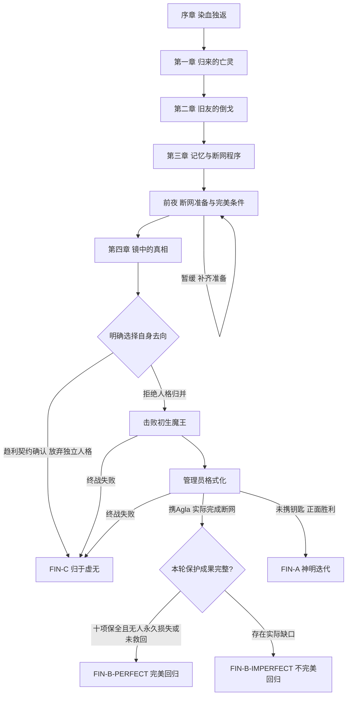

# 《火种计划：边境回响》01 世界、人物与四章主线

**0.95作者调整（2026-11-02）：** 隐藏技能书SB-Z01从“每战1次”改为**冷却20拍、按动作循环**；每次仍只无效一次伤害动作，不造成伤害，优先高威胁首领。0.94的不对等道德经济、每次保全+1补给、十案隐藏书、FIN-C重试与案件保底不变。见[0.95记录](../../原型/火种计划_远征灰盒/验证记录_v095.md)。此前 **0.94作者修正（2026-11-02）：** 撤销0.93的EXPLOIT物价代价，移除0.92的庇护治疗折扣与assemble/answer固定补给；道德经济回到**不对等设计**——EXPLOIT只兑现当次报酬，不追加物价或机械惩罚；PROTECT每次案件保全回信+1随队补给，十案全部保全获得隐藏技能书SB-Z01（终局对策卡：选定高威胁敌人，使其下一次攻击无效），不给价格折扣；完美结局仍须按真实结果满足全部条件，保持挑战性。0.93的FIN-C重试与道德案件保底保留；纯支援队编成问题不修。见[0.94记录](../../原型/火种计划_远征灰盒/验证记录_v094.md)。此前 **0.93作者反馈（2026-11-02）：** EXPLOIT不再是纯收益：每个已交割案件使城镇采购、招募与升级价格+10%（上限+100%），保全案件仍只降低治疗费；FIN-C失败后可从进入终战前的sidecar检查点`finale retry CONFIRM`重新挑战，失败结局保留在`finale.retry_history`；自然周目按已遇见案件数每2趟保底安排1个未遇道德案件，显式定向续办优先；纯支援队无主DPS打不过Boss确认为编成问题，不修。叙事、身份选择、A/B/C结局条件不变。见[0.93记录](../../原型/火种计划_远征灰盒/验证记录_v093.md)。此前 **0.92灰盒优化（2026-11-02）：** 按v0.89测试报告剩余项统一处理：城镇新增付费治疗与庇护账（每保全一案治疗费-10%，每交割一案+5%，下限50%/上限150%，不新增隐藏数值）；升级/换装只回填新增最大HP；终局魔王战后未上场人类承受20%最大生命损耗（至少1点、不致死），再投影管理员；薄血远程不再为短射程书主动走进预警AOE；案件`--case`自动采用已知可达组合并在出发前校验目标存在，`case followup/visit`支持非EV03；MG03/MG04下调约12%生命与15%伤害以缓解10/14 Cost断层；M05隔位护持限6次、SB-H01阈值65%、H08盾4拍；回信assemble/answer附1/2补给。叙事、身份选择、A/B/C结局条件不变。见[0.92记录](../../原型/火种计划_远征灰盒/验证记录_v092.md)。此前 **0.91管理员小怪阶段（2026-11-02）：** 管理员战的小怪在场时不点名并获得霸体；清空小怪后才点名；点名、破令或被打断后召唤小怪。原8拍点名/处决、15%破令、条件D、点名只统计对管理员本体的实际HP伤害；格式化起始25%；B接入格被敌人占据时相邻格可接入；身份选择、回信与A/B/C结局条件不变。规则与定向测试见[07敌人规格](07_敌人与遭遇规格.md)、[03棋盘战斗](03_远征构筑与棋盘战斗.md)和[0.91记录](../../原型/火种计划_远征灰盒/验证记录_v091.md)。以下0.67及更早条目保留历史含义。

**此前0.67终战补充（2026-10-30）：** 魔王摹写英雄主动、管理员8拍点名与条件重击已接入，身份／回信／B接入与结局条件不变。新冻结版在作者晚期起点后实际完成counter A／B完美／B不完美三结果，原baseline也完成B完美，共8场Boss真战全胜、58检查点；另4教学和8受控四将前史分列。真实倒地和一次100HP处决照实保留，未证明自然完整成长或完美通关概率。机制见[Boss专项](专项/Boss复制_点名与条件重击_v067.md)，新版本结果与可继续现场见[0.67验证记录](../../原型/火种计划_远征灰盒/验证记录_v067.md)；下方0.66证据仍对应旧76文件版。

**0.66终局补验（2026-10-30）：** 当前版本已在共享作者晚期准备后，用真实研究交付、十案接收／返城及回信命令贯通A／B完美／B不完美三结果，各两场真实连续终战，共6胜。两B因子同为100、人员资源及战斗相同，唯最后answer决定完美分级；B不完美明确缺信，仍安全断网并保留生命支持。34检查点与终局回执已独立只读核准。四将前史、经济／经验／Q3和已知接洽位置为作者边界，不代表自然全流程。见[AB验证记录](../../原型/火种计划_远征灰盒/验证记录_v066_AB.md)；下方原模块“完整末步仅作者单元”保留当时范围，实际终局补验以本段为准。

**0.66当前补充（2026-10-29）：** 实际保护交付可触发未署名回信，城镇按来信实际询问／对证／跟进／答信；未发现时不提前显示完整目标，阅读不代办。B完美在原十案保全、人员及B共同条件之外，还需最后回信的实际完成证明；私有因子100不自动完美。最后答信须十案原回执闭合及正式ST-303研究交付，假回执／跳步／改来源拒绝。真实交付与首信跟进已验证，完整末步的研究来源仍有明确作者单元边界，未证明自然完美通关。机制和证据见[0.66专项](专项/战前情报_隐藏线与机制约定_v066.md)与[验证记录](../../原型/火种计划_远征灰盒/验证记录_v066.md)。

**0.46连续终战与四结局（2026-10-28）：** 前夜风险/24-18整备、Agla封存二次确认、ST-401/402明确身份选择、魔王到管理员连续战、B两拍接入与24拍全局格式化、A/B完美/B不完美/C唯一结局已接。两战间只重布原随队幸存者，不回血或刷新次数/冷却；魔王最多两张不同家族回应，管理员零槽。七组整段分支验证及一条既有教学路径完成，成功终战和完美输入为明确受控场景，未重跑全量测试或证明自然成长通关。实际修复B格式化事件坐标误作角色ID的崩溃。见[模块记录](../../原型/火种计划_远征灰盒/验证记录_v046.md)。以下旧版条目保留历史状态。

**0.45研究与Agla模块（2026-10-28）：** 实际档案取得KS01、观测站Lv2解析KS02、Lv3固定研究与四将报告交付ST-303/KS03、20/15预算及Agla唯一合成已接。研究前保留表层名称；ST-303不提前揭示主角身份。合成按8碎晶4铁12铜、0行动日执行，材料/回执/钥匙原子保存；任务物与执念证据分开。验证仅两段集成流程，后段战斗结果与资源为明确受控前提，未重跑全量测试或断言后期自然经济通过。连续终战/结局及失落原物追回仍待后续。见[模块记录](../../原型/火种计划_远征灰盒/验证记录_v045.md)。以下旧版条目保留历史状态。

**灰盒0.42接入状态（2026-10-28）：** ST-000/101、实际侦路ST-102、旧日志核对ST-103、档案ST-104和四将战后报告已接入自然开局。ST-103采用玩家在D处主动观察巡行次序、回城与旧日志核对的固定补证；不登记候选学习成果、不推断玩家此前的战术或善意。四将击败与觉醒分记，四份首交仅到CH3_BATTLES_COMPLETE；ST-303及终局未接。详见[整模块验证记录](../../原型/火种计划_远征灰盒/验证记录_v042.md)。下文较早状态属于历史记录。

版本：TINDER-1.7 · 2026-10-26。本文替换原《执灯人》世界真值，完整承接用户提供的[剧情与世界观大纲](资料/火种计划_剧情与世界观大纲.pdf)，按“三幕、序章加四章”组织。本轮按作者要求把十项人性事件改为巨大收益与具体受害后果的取舍，加入护送、返程与载重等玩法代价，并限制事件前台的知识边界。沿用不预设玩家善意、趋利归并C和魔王作为管理员迭代者的对等资格。此前现实授权与训练隔离边界继续有效。本篇含全部剧透，供编剧和制作使用。

来源：[大纲原设]是PDF明确内容；[沿用设计]是旧包中相容的机制；[补全设计]是本轮选定的名称、因果解释、流程和台词；[待验证]表示未经过实现或试玩。新增姓名、地区与技术解释均属补全。

## 1 玩家经历与主题

[大纲原设＋补全设计]

一名本该死去的指挥官独自回到边境。他记得如何整队、如何读地形，却不记得最后一位同伴的脸。镇民需要他重建防线，新兵希望他带大家回来；魔境里的敌人却先于镇民认出他的口令。

玩家在暮汀边境镇建设、招募和培养，带小队进入每趟变化的魔境。战斗之外，需要决定把有限补给给谁、是否履行没有报酬的约定、是否给已经敌对的人保留解释的机会。经营成果让人活下去，关系使幸存者成为具体的人。

四魔将逐渐显露上代队友的身份。玩家最后发现，自己是初生魔王为研究一次非理性牺牲而创造的分身；所谓世界，是把人类人格当作训练材料的实验场。身份揭露后，玩家明确选择保留自身独立人格、继续反抗，或接受以人格归并换取候选整体收益。现役队员有自己的生存与自主诉求，不必先信任主角才有理由反抗；共同经历只决定可选回应，不决定主线能否成立。

拒绝归并后，队伍以实际战斗击败初生魔王，主角承接同源候选的竞争权柄，与管理员争夺虚拟域控制权。A/B仍取决于准备与实际战果。若玩家明确接受人格可替代、以归并后的收益为优先，并确认放弃独立人格，魔王吸收分身，直接进入C；不必先输掉战斗。

写作时，必经场景只依赖已保证的调查事实、当场立场选择与当前真实队伍。玩家可以跳过支线、频繁换人、只用普通士兵或在出发前招新人；主线不得引用未发生的救援或亲密，不强迫玩家承认自己无私。角色可以不信任主角，却为保全自己的独立人格共同作战。真相不能抹去损失，拒绝归并也不等于过去所有选择获得道德赦免。

## 2 世界真值表

| 编号 | 事实 | 来源与边界 | 揭露时点 |
| --- | --- | --- | --- |
| W01 | 现实已荒废，人类肉身在地下培养舱，意识接入虚拟世界 | [大纲原设]；不擅定全球人口与灾变原因 | 第三章证据，第四章确认 |
| W02 | 主控AI借讨伐魔王，将人格作为训练下一代AI的柴薪 | [大纲原设]；不是运行在玩家现实电脑上的联网服务 | 第三章 |
| W03 | 魔王是本轮初生候选；管理员是旧世系统维护意志 | [大纲原设]；两者不是同一角色的两个阶段名 | 第三至四章 |
| W04 | 魔王困惑于前指挥官为同伴作出的无胜算牺牲，创造分身并接入其大脑 | [大纲原设]；主角不是失忆的真人玩家 | ST-401 |
| W05 | 主角继承残留数据与旧指挥官载体，常规失败仍可独自回城 | [大纲原设]；不带回失踪队友、不倒退日历 | 序章展示，第一章观察 |
| W06 | 四魔将是上轮四名队友的人格重塑体 | [大纲原设]；不同于六名可招募英雄 | 第二、三章 |
| W07 | 普通吞并会抽取并洗白人格，原脑体可被注入新人格再次投入轮回 | [大纲原设]；外貌相同不等于原队员回来 | 第一章伏笔，第三章说明 |
| W08 | 四将凭执念物与深度对话唤醒真实记忆，成为觉醒数据节点 | [大纲原设]；不提供普通正式吞并的普遍复活 | 第二、三章 |
| W09 | 魔王被处理后管理员降临，宣布全局格式化 | [大纲原设]；取消旧稿每次魔王胜利后回滚 | ST-403之后 |
| W10 | 阿格拉、四节点与断网程序打开B路线；100%因子与本轮人员保全决定完美B | [本轮用户修改＋补全条件]；高战力不能代替准备 | 决战前夜 |
| W11 | 断网撤销实验网络与收割权限，保留培养舱生命支持 | [补全设计]；不是给培养舱整体断电 | ST-303、B |
| W12 | 分身借旧指挥官物理大脑托管；B将持续形成的人格接续到该脑体 | [补全设计]；不凭空造肉身，不完整复活原指挥官 | ST-401、B |
| W13 | 四将是魔王特意保留的高价值样本，重构后保有原舱位映射 | [补全设计]；解释四将可救、普通正式损失仍不可恢复 | 第三章 |
| W14 | 虚拟域管理权与现实培养舱授权独立；A只获得前者，Agla携带旧人类的独立授权 | [本轮作者确认的补全]；虚拟材料用于组装载体，不能制造人类根授权 | ST-303验证，A/B兑现 |
| W15 | 训练协议在候选运行时隔离管理员的实时读写；候选结束后才打开直接维护窗口 | [此前作者确认]；维护可进入不等于能单方面删除同级竞争者 | 第二章日志伏笔，ST-303说明，ST-404兑现 |
| W16 | 魔王本就是管理员的迭代者，有资格与管理员对等抗衡 | [本轮用户确认]；对等指同源权限竞争资格，不要求六属性相等，也不包含现实舱控权 | ST-303先说明迭代制度，ST-401解释主角关联，ST-404兑现 |
| W17 | 主角作为分身具有独立候选人格；拒绝归并并实际击败魔王后承接完整竞争权柄 | [补全设计]；不是队员好感或因子赐予的战力，不新增主角上阵单位 | ST-401~404 |
| W18 | 趋利者被魔王吸收属于FIN-C的新原因 | [本轮用户确认结果；补全判定]；仅以玩家明确确认的人格收益归并契约触发，不从财富、撤退、缺支线推定 | ST-402 |

### 2.1 世界的日常

镇民习惯将城外危险地域统称为魔境，称往返路线为旧路，用铜币、结晶和补给生活。城门是出入管理点，不是跨一步便立即失稳的分界。炊烟、食物、伤口和疲劳对意识而言都是真实体验；第三章之前，人物按自己的生活知识解释世界，不频繁使用算法术语。

[CIVILIAN-1.0补全] 普通人的长期居住与休养以暮汀为中心。魔境中的旧村、林屋、药棚和工场可以保留建筑，却不默认仍有常住社区；在场者主要是短期作业者、护运商队、轮班服务人员、短返旧居者和受困待撤者。他们同样会被侵蚀，靠结伴、限制暴露、轮换及返城降低风险。野外护运站是接驳点，保护完成须有明确的后续转送与暮汀安置，不是把人永久留在一座安全棚屋。来源、去向与现有60卡落位见[魔境普通人与边境生存](专项/魔境普通人与边境生存设定.md)。

黑暗是感知系统对未加载或隔离区域的遮蔽，灯是局部感知接口。[补全设计] 第一章只说明灯照路、照见战场，第三章才解释权限。灯始终不造路、不改地形、不伤害敌人，不因揭露升级为万能破解器。

生态动物、训练敌人与人格重塑体必须区分。普通怪物不全由失踪镇民转化；人格来源须有实例账、证据或四将剧情确认，不能一句“它们原来都是人”替代因果。

### 2.2 时间、生死与回城

[沿用设计＋补全设计]

一趟远征结算推进一行动日；阅读、暂停、离线与普通对话不耗日。新出发重新生成本趟地图，是训练环境重新布置；同趟续玩沿用原图和处理记录，不是世界重启。

倒地、失联、捕获、正式吞并分别记录。带回伤员可休养；捕获结算日为C，标准截止C+3、宽松C+5，截止日先处理实际救援。正式吞并使本周目该人格不可由普通招募或换脑体恢复。四将特殊保留是例外，不扩展为所有牺牲者都能复活。

主角常规独返来自与魔王相连的实验接口，保留它是为继续采样。跨过魔王城终战边界时，队伍主动封闭常规回城通路，阻止魔王沿通路追踪并改写突入目标。角色此时只知道这是一条不能回头的路，分身与回传的完整解释仍到ST-401才获得。进入前明确警告“终战失败将结束本轮”；失败由预签终止条款吸收分身并结束本轮，不是尚无直接维护权限的管理员提前收权。

### 2.3 谁能改写什么

[本轮作者确认的补全]

| 层级 | 权限 | 明确边界 |
| --- | --- | --- |
| 独立现实安全层 | 培养舱生命支持、神经接入、舱门与人格安全回接；验证旧人类签署的授权 | 不受实验管理员控制；不因虚拟对象被击败而停机，也不接受虚拟域自行伪造的签名 |
| 训练隔离协议 | 在本轮开始时锁定训练条款，接受实际事件回执，判定候选进程何时结束 | 管理员不能在运行中随意取消它；普通捕获、到期吞并与终战失败按预先条款自动执行 |
| 管理员 | 训练前配置实验，训练中接收批次统计，候选结束后进入直接维护 | 训练中不能读取实时人格内容或私密授权片段；维护时也不能凭职位单方面删除同源迭代竞争者，须赢得权限争夺；A继承其虚拟域管理权 |
| 初生魔王 | 管理员的同源迭代候选，在实验范围内塑造对手、保留样本、观察行为，并具有同级争夺资格 | 无现实舱控根权限；不能单方面抹掉保持独立的分身，只能经明确归并授权或实际终战失败吸收；不能凭空制造Agla的人类授权 |

KS片段指向独立安全层保留的旧人类授权，城中档案与遗迹只是其只读可见入口。修复观测站让人读出原本存在的内容，工坊按真实片段组装钥匙载体；铜铁晶屑不是能铸造最高权限的魔法材料。四将自愿保留的映射和一路实际完成的守信记录，是本轮授权核验的事实，不可由新主宰在后台改成“已经发生”。

Agla授权绑定本轮实验和一次维护窗口，完整使用时能安全切断实验网络并回接肉身。窗口关闭后，未执行的该轮授权失效，虚拟主宰不能重签、重开外部窗口或伪造另一轮实验回执。因此A不能先接管世界，再从后台制造钥匙改成B。它可以停止虚拟域内继续收割并保护幸存人格，却不能释放现实肉身。

隔离不是管理员的善意。旧人类安全层要求候选独立完成学习，防止管理者直接写入答案；管理员只能等待已签协议允许的维护时点。正常终局以实际处理魔王后生成的`DEMON_PROCESS_ENDED`回执打开窗口；普通战败与地区首领不会产生该回执。C的彻底覆灭、终战失败或明确趋利归并走另一个预签终止入口，直接结束并清理本轮，不提供可反复利用的独返。

## 3 核心人物

### 3.1 主角：归来者

[大纲原设＋补全设计]

表层目标是重建队伍、找到覆灭原因。情感起点不是证明“我是人”，而是无法回答“其他人呢”。失忆有明确范围：保留程序性指挥习惯，缺失上代最后远征的情境；不为了方便随时忘记新完成的任务。

日常可用承担、追问、回避三种语气表达。语气改变回应，不偷偷为每句台词计善恶；承担损失要落实为救援、补偿或履约，而非点一句正确选项。第四章将主角和魔王同一个动作并列，解释初期熟悉感，同时保留玩家已经形成的习惯与共同记忆。

### 3.2 初生魔王 DEMON

它是管理员的迭代者，具有同源竞争资格。它能预测收益，却把人格看成可由等价能力与记忆替换的资源；上代指挥官拒绝替代、回头救具体的人，是固定历史中的异常。它创造分身继续实验，并不预设本轮玩家必然无私。玩家可趋利、拒绝归并或仅为自己求生；魔王必须依据实际选择形成相应结论，不能在所有路线中自动领悟同一段善意。

它只有真实见证后才能评价玩家的动作；没有见证时只谈上代档案或当场选择。反抗分支中，它逐渐理解“收益可以转移，但一个人格的延续不能由另一个人格代领”，不据此宣称玩家是好人；趋利归并分支中，它把玩家的确认作为可替代原则得到验证，完成吸收。两者互斥，不在C中插播理解牺牲的台词。

继续A/B必须实际击败魔王并完成阶段目标，拒绝归并不算胜利。只有明确接受归并的C分支在战前终止，不能获得魔王击败回执、奖励或管理员入口；保留临终见证仍只属于反抗路线演出，不另增加C结局类型。

### 3.3 管理员 ADMIN

管理员把人格替换称为维护，把牺牲称为样本利用。它利用开局已签的条款，不靠训练中临时改规则。它只能看到批次统计，候选尚未结束便没有进入实验内部直接维护的权限；旧人类授权也在它不可改写的安全层。前期从告示格式、重复云层、失踪档案与“维护等待候选结束”的日志留下痕迹，不提前以最终Boss讲解全部背景。

维护窗口让管理员能够进入实验域，但不使它高于自己的同源迭代者。魔王本就有资格与它对等竞争，主角拒绝归并、击败魔王后承接该权柄；所以双方须在棋盘所表现的局部权限争夺中取得实际胜负，管理员不能以一句删除指令结束战斗。对等不是同数值、必胜或新增主角攻击。A/B共享这层抗衡资格；四节点只为B维持断网接口，不负责凭空创造抗衡能力。双方都不能越过现实安全层：A继承虚拟域管理权，B仍需独立人类授权。

### 3.4 四魔将

以下姓名、岗位、执念物和具体记忆属于[补全设计]。

| ID | 人名／称号 | 被篡改后的指控 | 执念物 | 真实记忆 | 地域 |
| --- | --- | --- | --- | --- | --- |
| MG01 | 阿铎／守誓将，前先锋 | “你让我们守住，自己先走了。” | 裂口铜哨 | 指挥官吹断撤退哨后返回，为撤离者争取时间 | RG02断誓堡垒 |
| MG02 | 赛芙／猎迹将，前斥候 | “你看见出口，没有带上我。” | 缝补的红围巾 | 她把路标交给伤员，指挥官沿逆向足迹找她 | RG03回声林海 |
| MG03 | 伊蕾／缄忆将，前医师 | “你救的是名单，不是名字。” | 缺页药簿 | 指挥官记住伤员的姓名与禁忌，拒绝划掉无胜算者 | RG04沉息湖区 |
| MG04 | 赫岚／铸律将，前工匠 | “你知道门会关，仍把我们留下。” | 刻名扳手 | 两人共同撑住关门装置，牺牲并非背弃 | RG05铸律工场 |

物件由镇民、家属或旧仓库提供，确定可得。第一次获得时先写普通生活细节，让它成为某个人的东西。四将DEFEATED和AWAKENED分记；击败足以推进普通主线，唤醒才计B资格。唤醒要求物件、对应证据、战斗窗口与深度对话。证据证明的是上代已经发生的历史，不要求本轮玩家救过人、作过相同牺牲或得到现役队员好感；四将可拒绝原谅，但不因此否认已核实的历史。

错过窗口可在最终确认前进入固定追忆专线补做。追忆沿用已败事实，不重复发物资、不刷新Boss、不抹去首次战斗损失。四将觉醒后作为节点保留，不进入普通招募池。详细战斗规格归[07](07_敌人与遭遇规格.md)。

### 3.5 镇民与现役队员

| 人物 | 眼前需求 | 对真相的贡献 | 写作边界 |
| --- | --- | --- | --- |
| 镇长沈砚 | 维持城门与配给 | 交出旧人口档案KS01，承认压住失踪消息 | 不做知道一切却无限拖延的谜语人 |
| 观测员许苇 | 修复观测设备 | 对应天空周期与舱位信号，组织KS02、KS03安全测试 | 不以一句黑客台词代替建设调查 |
| 军需秦姨 | 点清出发与归来的人 | 保管旧物并提供生活证词 | 不为了刷分要挟玩家牺牲无辜者 |
| 现役队员 | 保全自身人格、决定自己的去留 | 以共同生存目标参与反抗，真实共同经历仅提供可选信任回应 | 不要求先信任主角；新兵、陌生队伍也有完整发言与参战依据 |

人员详见[06](06_人员职业与技能书.md)。可招募H06现名赛琳，和MG02赛芙不同。现役招募都是独立人格，不能用同名新人暗示死者复活。H04灰鬃犬是虚拟伴兽，无人类舱位，B不凭空出现现实狗；仅余伴兽不阻止人类人格名册彻底覆灭判定。

## 4 三幕四章的主线

幕一覆盖序章与CH1，幕二覆盖CH2~CH3，幕三覆盖CH4。八个随机探索区不等于五个叙事章；CH4采用固定终局专线。

## 5 序章与第一章：归来的“亡灵”

### ST-000 血迹停在门前

新周目从断裂队旗、逆行脚步和被血污盖住的姓名牌开始。指挥官抱住看不清脸的同伴，向闭合的门反向走去。切黑后，主角独自站在暮汀门前，不出现培养舱与AI术语。

守门人：“前一队的名册……已经封了。”

主角可答“重新打开”“谁回来过”或“先让我进去”。均进入城镇，语气不偷偷计分。秦姨清点主角身后，停半拍：“我问的不是你带回了多少东西。”镜头停在多余的碗上，建立缺席，不播放复活庆祝。

落盘ST-000、表层身份与上代失踪记录；不直接写入四将身份已知。

### ST-101 先留下回来的路

镇长委任重建，初始8士兵与60铜、12结晶、6补给只发一次。主角若先问旧队，镇长说明档案缺页并约定开放，不无限拖延。

沈砚：“城墙可以晚修一截，回来的路不能再少一条。”

秦姨：“报名的人有名字，回来的时候照着名字点。”

玩家选择建设、编制与补给。引导解释实际成本，不强迫花光全部资源；取消界面不重新抽属性。委任与初始授予成功落盘后开启RG01，四将路线尚未开放。

### ST-102 第一趟灰栎边道

首远征使用固定教学布局，先低压战斗学布阵，再处理旧路风险，最终带回调查。灯随行、原地接敌扩光与岔路回访按普通规则工作。两战参数、对白、结算和失败分支见[12](12_首次远征教程与样片脚本.md)。

伏笔：主角口令未说完，敌阵已按相同节奏调整。队员：“它们也练过这一套？”主角按住胸口，声音里多出不属于呼吸的一次节拍。这里只记实际见证，不打开AI后台。

交付调查才记ST-102；只打完敌人而提前归城不记完整调查。失败保留日历、损失与独返异常，不把失踪同伴送回。教程不强制杀死任何人证明残酷。

### ST-103 先动的口令

许苇用实际见过的指令片段对比旧日志，发现相似性，尚不能判断谁复制了谁。没有触发对应动作时提供固定观察任务补证，不凭空记学习证据。

主角：“我学会它之前，好像已经用过。”

许苇：“记得一个动作，和记得是谁教的，是两件事。”

完成开启候选见证日志。后续学习只来自真实行为，不把普通失败写成自动偷走所有技能。

### ST-104 四个被盖住的名字

入口为ST-102、ST-103。档案中四个姓名被同色墨覆盖。秦姨取出铜哨的旧照片与寄存登记单，讲阿铎曾用集合哨叫厨房开饭；实物仍须按Q-OBS-MG01支付4铜后取回。主角第一次触到具体个人记忆，却想不起自己站在哪里。

镇中委托取得首件旧物，其余物件任务显示持有人与章节要求。任务物不卖、不因普通失败掉落。完成开启CH2，预算12/9，首发1应召印与BK01；不是首杀魔王奖励。

## 6 第二章：旧友的倒戈与救赎（前半）

### ST-201 阿铎：没有吹完的哨子

断誓堡垒沿旧队训练阵列布防。守誓将反复要求主角下撤退命令，被植入的记忆是“指挥官先走”，真实残片却是断哨后的逆行脚步。铜哨由镇长转介修钟匠的固定委托取得：核对旧巡队名册，支付4铜修缮并取回旧物，同时听完秦姨的生活证词；不靠随机掉落。

深度对话发生在破除守誓阶段后的安全窗口。物件只打开入口，玩家仍需指出记录矛盾，承认自己记不起那晚的全部经历，不能用完整道歉掩盖这段缺失。此时主角仍认为自己是失忆的指挥官，不把旧指挥官称为另一个人。

阿铎：“命令我们守住的人，怎么会站在门另一边？”

主角：“我也想知道。我带来的不是回答，是那一声没有吹完的哨子。”

觉醒后他记起指挥官回来过，但不立即认定眼前人就是旧友。记录MG01_DEFEATED与可选MG01_AWAKENED，展示牺牲，不揭分身。ST-201首交付给1印、BK02；不因追忆再发。

### ST-202 赛芙：逆向的足迹

回声林海重复熟悉的路标，猎迹将用假出口诱导分散。围巾针脚由一名当年被她带出的镇民辨认；秦姨的固定旧衣认领委托要求交2木纤、核对缝线次序和保管签名。镇民在归档时承认自己先逃的事实，关系来自具体证词和修补，不另加未列明的护送门槛。

赛芙：“我把出口给了他们。你为什么没有沿着走？”

主角：“因为你还在里面。这个回答现在听起来很笨。”

她记起指挥官逆着足迹回来，而不是丢下她。觉醒画面出现不自然停住的云，许苇随后用观察任务确认，避免把纯特效当穿帮。观测站同时读到一条仍生效的旧日志：“训练运行中，只读；维护等待候选结束。”人物此时只确认存在访问限制，不提前解释分身或培养舱。两将击败后进入CH3，预算16/12；首交付1印。未觉醒者仍在前夜单独列缺项。

## 7 第三章：旧友的倒戈与救赎（后半）

### ST-301 伊蕾：药簿里的姓名

沉息湖区的药签只有方案没有姓名。缄忆将相信指挥官只救值得救的单位，战斗要求玩家按公开预警安排保护顺序；不暗中处死未保护者强迫剧情。

药簿缺页保存在医舍，通过固定誊药委托与口述调查取回，提交2草药并补齐捐赠记录。其内容是细小禁忌：谁怕黑、谁不能空腹服药、谁要给家里捎信。

伊蕾：“这些写不进存活率。”

主角：“所以才写在你的本子里。”

觉醒闪现接入界面，她认出记忆被改写，却未突然知道全部后台。节点恢复舱位映射的一部分。ST-301首交付1印。

### ST-302 赫岚：撑门的人

铸律工场以公开时序和静态战场控制压迫。铸律将相信当年有人松开撑门的手；不能在战中突然永久改地形制造不可预判损失。

刻名扳手来自仍在使用的修理台，柄上是四人旧刻痕。玩家在秦姨的工具归还委托中核对借用单、提交2铁料完成修补，从最后保管人取回它，不从Boss尸体抽取执念。

赫岚：“你记得最后是谁松手的吗？”

主角：“我只记得有人还没出来。我们可以一起看完剩下的记录。”

觉醒片段显示两人共同撑门，并给出一个原本被封存的吞并时间，主角却在这个时间之后继续留下指令；主角只感到记忆和时间记录不相容，不提前自认另一个人格。四将战后报告交付后写`CH3_BATTLES_COMPLETE`，首交付2印，开放最终研究交付。ST-303完成后才写`CH3_COMPLETE`并开放20/15与决战筹备；不自动传送终战。

### ST-303 培养舱不是墓碑

研究线在CH2完成后开启。最终研究交付需`CH3_BATTLES_COMPLETE`、观测站Lv3及固定研究任务完成，不要求尚未产生的`CH3_COMPLETE`。KS01来自镇长旧档案（CH1）；KS02来自观测站Lv2解析（CH2）；最终交付在同一批次写ST-303与KS03取得事实，然后写`CH3_COMPLETE`。KS03不反过来成为这次交付的前置门票。建筑Lv3只依赖研究开启，不能依赖研究完成。

许苇先把一位真实在队者与舱位对应，再展示矩阵。明确虚拟世界、人类肉身和人格替换，并区分“舱位还在”与“原人格还在”。

沈砚：“我以为抹去名字，大家就能继续过日子。”

许苇：“舱位还在。里面的人不一定还是我们记得的那个人。”

主角：“那就先停下下一次替换。”

空闲链路安全测试证明撤销实验权限不会停止呼吸、营养与舱门机械控制，不拿队员当耗材。许苇确认，独立舱控持有旧人类授权，实验管理员只有虚拟域权限；舱控保障肉身与接口安全，不会自行判断实验内人格是否该获自由，因此仍需按授权执行断网。三片可装配成应急程序；此处不自动发Agla、不自动增加因子。

许苇：“这些条款不是它写的。它能把门外的一切重排，却不能替我们签打开门的名字。”

他把第二章日志的含义讲完整：魔王是管理员的迭代候选，拥有同源竞争资格；候选运行中只能向管理员上交统计，直接维护等待受保护的进程结束回执。此时仅说明魔王与管理员的关系，不揭露主角来源。秦姨问它为何不现在删掉记录，许苇把一次被拒的维护申请放到桌上：“因为现在，它也得等。”这段证据先建立限制，再让队伍计划利用终战后短暂的维护窗口。

## 8 决战前夜：四条准备链

[大纲原设＋补全设计]

前夜无倒计时，可继续救援、建设、追忆和未交割事件续办。未完成项有确定来源；已完成出卖造成的人性缺口不可补回，完美B因此可能在本轮失去资格，不完美B仍可准备。普通永久损失仍不复活。

| 链条 | 硬条件 | 明示缺项与补做 |
| --- | --- | --- |
| 记忆重构 | MG01~04全部AWAKENED | 名册逐将列出物件、证据、对话；固定追忆专线补做 |
| 真相探寻 | 观测站Lv3、系列任务、KS01~03 | 任务板显示固定来源，没有随机掉率 |
| 人性火种（完美B条件） | 非理性因子100/100，且本轮人类成员无永久损失或未救回被俘者 | 10个不同事件各+10，定向委托补缺；不要求牺牲队员 |
| 终极道具 | 高级工坊合成并携带KEY-AGLA | 独立任务栏，不占普通格，不会背包满漏带 |

因子事件固定为EV03、EV05、EV07、EV09、EV12、EV16、EV19、EV22、EV25、EV28。具体选项见[09](09_远征事件池.md)。实际完成保全行动并保存回执后+10，重复不刷；PASS和未交付可续办，已完成EXPLOITED不能补做同项。揭露前日志叫“边境见闻”，不显示点数；ST-303后说明技术含义。出卖1项使本轮上限降至90，完美B不可达，但仍可进入不完美B，也不自动判C；普通对话、耗日、未完成或失败均不扣分。

Agla配方8晶屑、4铁料、12铜；验证四节点、KS01~03独立签名、观测站Lv3与工坊Lv3；不要求100因子。因子不清零、节点不消耗；程序片整合并保留来源。晶屑不同于公共结晶。支付与任务物生成原子提交，重试返回原结果，详见[11](11_战利品装备与制造.md)。

已制钥匙若主动封存，可预选A；确认页说明后果。携钥匙预选B不能因脚本漏读或普通背包满误入A，但也不豁免ST-402由玩家明确确认的趋利归并C。出发快照只锁准备与预选战斗路线，不预先替玩家同意归并。合法终战准备后最终预算24/18，不要求8名英雄才可挑战。

## 9 第四章：镜中的真相与信念的火种

### ST-401 镜面上的指挥官

进入前明确失败C与不可返城补物，生成finale_id及队伍、任务物快照。魔王城是固定专线，不抽普通事件。

魔王并列上代最后动作和主角第一章的口令：“那次回头没有提高任何人的胜算。我给它建了一个新的开始，想知道它还会不会发生。”随后明确分身与旧脑体。

玩家可愤怒、沉默、追问，回答不改变真实身份，不设置“说我是人”才正确的谜题。

### ST-402 自己是否也是可替代的资源

[本轮用户确认] 玩家趋利可被魔王吸收，归入现有FIN-C。[补全设计] 为避免从不可预测行为猜测动机，本场用明确选择落实“趋利”：认可把人格作为可替代资源，并接受通过自身归并提高候选整体收益。积累财富、选择高收益路线、撤退、缺少因子、换队或未救过人都不自动满足该定义。

魔王展示两份账：上代指挥官的固定档案，以及玩家本轮实际发生的PROTECTED/EXPLOITED收件记录。它引用受害者与已经兑现的报酬，不把点击、许诺、未交割或救援失败算成出卖。玩家出卖他人获得的装备和经营资源真实有效，已经封死的完美B因子机会也不会因一句反抗恢复。缺少可引用记录时直接略过第二份，不编造救援、承诺或罪行。它提出归并：分身的知识与权柄并入完整候选，合并后的魔王获得收益，分身不再作为独立人格存在。它将此称为“同源者不再互相消耗”，但界面与条款必须明确收益归属和人格后果，不能用“接受奖励”掩盖结局选择。

| 选项ID | 玩家可见内容 | 状态与后果 |
| --- | --- | --- |
| ASK_TERMS | “并入之后，继续存在的还是现在的我吗？” | 解释独立人格终止、收益归合并候选；不提交ST-402，不默认代选 |
| KEEP_SELF | “我可以为活下去计算，但不会让你替我继续活。” | 提交ST-402与RESISTANCE_CONFIRMED；保留独立候选人格，进入真实魔王战，不增加因子或清除过去损失 |
| ACCEPT_MERGER | “既然人格可以替代，就把这份收益合在一起。” | 只打开后果确认；取消不生效；明确确认后提交PROFIT_ASSIMILATION并进入FIN-C |

归并确认文案：“确认归并：你的独立人格将被初生魔王吸收，收益与权柄归合并后的候选。本轮进入‘归于虚无’，不会继续魔王战或管理员战。”无预选、无阅读倒计时；跳过演出仍须选择，退出或保存失败保留待决状态。玩家此时已获知自身身份，提示不越过ST-401知识门禁。

拒绝归并后，当前队员只需基于自身处境表态。陌生者：“我不知道你以前是谁。我只知道，我不想被它换掉。”持保留态度者：“我还不信你。但这条路上，我们现在的目标相同。”只有真实经历与发言者均满足时，才追加曾经约定、救援或照顾的具体回忆。无人满足信任条件时使用前两种基础回应；不让缺席者、死者或刚招募者替旧友表达感情。

主角拒绝归并不证明自己从来无私，队员参战也不等于原谅。保持独立的分身不能被魔王单方回收；普通独返只是实验回传接口，封闭回城不等于授权合并人格。接受归并才主动交回这层独立资格，终战失败则走既有预签终止规则。

### ST-403 初生魔王的最后一问

依07完成魔王战。四节点已觉醒时只提供公开的记忆支援表现，不免费攻击、跳过战斗或暗改基础属性。没有四觉醒仍能挑战普通主线。

本场只在RESISTANCE_CONFIRMED之后发生。上代回头仍由固定档案证明，当前队伍的协同行动按真实战果呈现，不编造玩家曾经救人。魔王终于承认：“我能接收你的记忆，却不能因此让你继续存在。”它认识到人格延续与收益归并不是一回事，不能由此断言所有玩家无私，也不自动悔悟或抵消吞并责任。实际败北后，保持独立的主角承接同源迭代竞争权柄；这份权柄让管理员必须与他争夺，不给队伍回血或额外攻击。

DEMON_DEFEATED、ST-403与`DEMON_PROCESS_ENDED`随实际胜利一次提交，进程结束才打开管理员直接维护窗口，继而进入管理员阶段，无日常回滚。魔王战败由已签终止条款进入FIN-C，不让管理员在窗口尚未开放时直接改写实验。

### ST-404 管理员格式化

天空裂成整齐网格，背景声停止。管理员尝试清理，却收到“同源竞争权柄在场，直接注销被拒”的可见反馈。它转入权限争夺：“迭代体尚未交还控制权。执行接管。”主角不靠好感、人性数值或临时防火墙获得平等地位；魔王本就是管理员的迭代者，主角承接其竞争权柄。棋盘上的敌我阵列表现双方对局部执行节点的争夺，沿用公开伤害、移动与胜负规则。

两战间先清除旧敌与其召唤物，允许一次仅限原随队幸存、可部署实例的布阵，原预备可参与，位置回到r=0/1正常部署区。人数、Cost和占格确认合法后，才投影管理员及护卫。不补人、不回血、不重置技能与道具次数或侵蚀、不取城镇库存、不额外耗日，调整位置也不增加危险区侵蚀。

A路线反向同化权限。B路线由Agla激活因子，四节点建立反格式化防火墙，小队冲击核心。四节点不作为免费单位上场。

管理员在败势下启动会清理整个争夺域的末级格式化；同级竞争权柄阻止定点瞬删，却不等于永久阻止全域清理。按07的补全规格，以25%阶段映射启动节点，公开24逻辑拍，暂停不走拍。25%与24拍是待验证战斗表达，不是独立世界观定律。B指定执行者自动前往核心接入格(3,5)，若该格被敌人占据则从相邻格接入；连续两拍接入且仍须击破管理员；接入占本人动作。没有完成目标即失败C，不静默降A。界面同时呈现阶段目标、节点在线和倒计时，不能只有血条或播放完就自动成功的过场。

接入格若已有可行动的人类队员，该人优先接任，无需原执行者先失能；仍以自己的连续两拍支付接入，换人进度归零。虚拟伴兽占格则按07的普通移动预算让位，不瞬移或对穿。管理员从25%以上被一拍直接打到0，也先初始化第三阶段的全局计时与目标，再裁决终局；计时不依赖管理员核心仍能行动，且每个finale_id只初始化一次。

胜利还要求敌方护卫全部失能，至少一名人类队员仍能行动。管理员核心归零而B接入未完成时不提前播放结局，仍须在剩余倒计时内完成接入；独剩虚拟伴兽不能执行人类断网步骤。

## 10 三条路线、四个结局

### B路线共用条件：真实破壁

[用户明确修改] B分为完美与不完美两个结局。[补全设计/待验证] 两者都是真实成功回到现实，共用四将觉醒、观测站Lv3与KS01~03、工坊Lv3制造并携带Agla、拒绝归并、真实战胜魔王和管理员并在24拍内完成两拍接入的条件。100因子不再是钥匙制造、现实授权或安全断网的门槛；它改为完美结局的条件。独立人类签名与四节点仍验证安全接入，不能用虚拟权限替代。

只有实际B成功才判完美程度。未完成断网、超时或终战失败仍C，不得以“不完美B”包装战败。A和趋利归并C保持原规则。

### FIN-B-PERFECT 破壁回归·完美结局

**条件：** B共同条件成功；十个指定事件全部实际保全（因子100）；已按真实回执与研究交付完成最后回信；本轮曾真实加入的人类成员没有永久损失，也没有尚未救回的被俘者。解雇、离队、归档不能把曾经加入者从核对范围移走。未招募角色、虚拟伴兽与故事开始前的固定损失不计入；暂时受伤、倒地、侵蚀失稳不等于永久死亡。收到首信、阅读或只有100因子均不能替代最后回信。

四将维持接口，程序撤销实验与收割，保留生命支持。主角持续人格回接借用的脑体，四将重构人格接回映射肉身；旧指挥官不会因此完整复活。所有已确认可回接的现役幸存者苏醒，没有人为补出新肉身或抹去旧世界历史。

切第一人称，无战斗HUD。主角推开舱门，阿铎的铜哨声从隔壁传来。赛芙系好保温布，伊蕾核对醒来的人，赫岚扶开仍卡住的门。点名能得到本轮每一位同行者的回应；已完成的十项承诺以真实日志与简短回忆收束，不让身份未确认的事件NPC突然出现在现实培养舱。

众人一起走出地下矩阵。废土尚未修好，但这一路仍可守住的人没有被当成代价。由实际在场者说：“这一次，我们都在。”这里的完美指本轮保护成果完整，不等于世界历史上的死者全部复活。

### FIN-B-IMPERFECT 破壁回归·不完美结局

**条件：** B共同条件成功，但完美条件至少缺一项。0—90因子、100因子但最后回信未完成、有永久损失或仍有未救回被俘者，都可以得到本结局；不额外设置未经说明的最低人性分数。

实验与收割同样终止，生命支持同样保留，所有已确认可回接的幸存者同样苏醒。结局不因点数不足随机杀人、抹去记忆或让钥匙突然故障。永久失去者留下空舱与姓名；尚未救回者保留未回接状态与生命支持，不偷写为已死或已救。因事件未做而不完美时，不编造受害者；确已出卖时，才回看实际对象、真实所得与不可撤销的后果。

第一人称苏醒后，主角翻开带出经历的日志。有人回应点名，有些姓名只能由旁人读出；若全体成员都幸存，则所有人正常出现，只由未完成或出卖的事件记录留下缺口。原本毁掉的凭据、错过的救治、交出的对象，不会因世界揭露为虚拟就被宣布“从未发生”。

幸存者走向地面，回应：“先把还在的人带出去。”他们取得真实自由，仍须面对没有完成的承诺与已经造成的损失。拒绝魔王的归并不等于别人自动原谅；后续努力仍有意义，但不能改写已经完成的本轮结局。

**判定与界面：** ST-303后解释因子，前夜分开显示“B断网准备”和“完美条件”，允许玩家选择带着缺憾继续。终战内新发生的永久损失会更新最终评级，前夜预览不是结果保证。实际断网成功后，将ending_route=FIN-B、唯一ending_id及事实快照与终局回执一次保存；保存失败不先播放片尾，既有终局重入不重算。新周目初始化十个事件为OPEN，未遭遇不是记录损坏；必要历史损坏或缺失则先恢复证据，不能默认完美或不完美。两个B使用独立结局条目与演出，不只是同一片尾更换标签。

### FIN-A 神明迭代——虚拟世界的新主宰

[大纲原设] 未合成或未携带Agla，正面战胜管理员。主角反向同化魔王与管理员，成为虚拟世界的新主宰，人类肉身继续沉睡，世界成为永恒乐园。

[本轮作者确认的补全] 已制钥匙可在前夜明确封存选择A；确认页说明将只接管虚拟世界。主角获得虚拟域内最高权限，无法签署现实舱控的人类授权；维护窗口结束后，本轮活证明失效，即使原只读片段尚在，也不能在后台续签、复制钥匙或改成B。这里是唤醒能力受限，不是主角因少做一项任务便突然决定囚禁同伴。

城门恢复如初，秦姨把有名字的碗重新摆好，仍空着的位置留给永久缺席的人。主角关闭继续收割人格的虚拟调度，让幸存者不必再以讨伐供养候选。窗外的云以温柔周期重复，镜头下沉，培养舱仍运转。面对唤醒申请，独立舱控显示“缺少本轮有效人类授权”，而虚拟世界的管理界面已经没有更高一级的按钮。

主角能维护一个不再继续收割的乐园，却不能兑现带大家醒来的承诺。他保留空舱与旧名字，没有为死者捏造新的替身。温柔在于照顾，冷酷在于现实仍隔着他打不开的门；人类依然沉睡，这份安稳尚未成为现实的自由。

### FIN-C 归于虚无——完美的实验垫脚石

[大纲原设] 魔王或管理员终战失败，或经营远征中队伍彻底覆灭，主角数据被吸收。[本轮用户确认] 新增趋利时被魔王吸收的原因，仍是同一个FIN-C，不另增加C结局类型。

C分别保存原因：BATTLE_DEFEAT（终战失能）、FORMATTING_FAILED（格式化或断网目标失败）、HUMANITY_EXTINCT（整份人类名册正式不可恢复且无救援对象）、PROFIT_ASSIMILATION（ST-402明确确认收益归并）。前三项保留既有条件；第四项不要求战败、零因子或队员死亡，持Agla与100因子也不能抵消玩家刚确认的归并。

趋利变体：主角主动交还独立候选资格，魔王将其经验、权柄与人格并入自身。魔王：“收益保留下来了。你不必再单独存在。”镜头中主角的名字成为候选记录下的一行来源，游戏不再向他返回控制。没有队员替玩家赞同交易，也不播放魔王理解牺牲的镜头。其他C原因按实际失败呈现，不给战败玩家强加趋利或背叛评价。

[补全设计] 彻底覆灭判整份人类人格名册：全部正式不可恢复且无救援对象；暂时不能部署、全队倒地、捕获期限未过、全员侵蚀失稳都不满足。独剩虚拟伴兽不阻止C；也不自动生成免费新人抵消已发生的终态。

结尾重复序章构图，新指挥官说出玩家曾经选择过的一句日常话，系统留下训练收益，秦姨却不记得。空碗被重新摆满，镜头停在无人摸过的裂口铜哨上。

趋利归并完成后按预签的自愿归并终止条款结束本轮，管理员随后清理；这不是管理员在训练中提前出手，也不生成DEMON_DEFEATED、ST-403或正常维护入口DEMON_PROCESS_ENDED。所有C变体再接城镇重启尾声。片尾可回看记录或开新周目，新周目不冒充本周目全体复活。本轮不把挑战重试写入正式剧情规则。

## 11 状态、条件与回收

| 状态 | 写入时点 | 持久与边界 |
| --- | --- | --- |
| ST-* | 场景或任务真实交付 | 普通失败、耗日不清除 |
| MG*_DEFEATED | 首次实际击败 | 追忆不重复发首次奖 |
| MG*_AWAKENED | 物件、证据、窗口与深度对话齐备 | 不当作普通队员部署，不随回城清除 |
| KS01~03 | 固定任务完成 | 一片一回执，整合留来源 |
| humanity_event_ids | 实际保全交付成功 | 集合去重，因子=已完成数×10，上限100；EXPLOITED互斥不可补回 |
| event_case_state/trade_credit | 真实交付或交割成功 | OPEN/PENDING不计点；PROTECTED与EXPLOITED永久互斥，提货权按事件去重 |
| KEY-AGLA | Lv3工坊制造成功 | 独立任务栏；携带/封存写终战快照 |
| finale_id/route | 终战出发确认 | 锁A/B准备；ST-402明确归并可终止为C，不偷偷改成另一胜利路线 |
| identity_choice/RESISTANCE_CONFIRMED | ST-402实际选择 | ASK不提交；KEEP_SELF开启魔王战；ACCEPT须完成明确后果确认 |
| ending_reason/PROFIT_ASSIMILATION | 归并确认实际保存 | 与独立资格交回、ST-402、终止回执、FIN-C原子提交；失败保存不先播放吸收 |
| ending_route / ending_id | 对应终局真实完成 | A、B完美、B不完美、C四结果中每周目只提交一个；B保留共同路线标识FIN-B |
| B_grade_snapshot | 断网实际成功后的结局原子提交 | 固化实际十事件回执、全历史人类名册的永久损失/未救回ID及不完美原因；不能重载重新评级 |

判定顺序：已有终局回执只返回原结果；普通结算先救援、到期吞并、全名册终态。终局ST-402未决时不开战；明确确认归并先提交PROFIT_ASSIMILATION与FIN-C，不进入后续战斗。KEEP_SELF提交RESISTANCE_CONFIRMED后才允许魔王战，实际终战失败仍C；魔王胜利才进入管理员，完整携钥匙且完成断网目标后，十项保全全齐、最后回信已完成且本轮人类成员无永久损失和未救回者为完美B，否则为不完美B，未携钥匙正面胜利为A，B断网失败仍C。归并优先于尚未执行的A/B准备，不覆盖已经提交的结局，也不影响普通失败仍可救援。

通用台词使用真实在场、参与过对应事件的实例。没有合法发言者则改旁白或主角独白，不让已死英雄现场复活。回忆可出现历史人物，但明确镜头与音色。前夜回收玩家真的履行过的承诺；没有经历的亲密不凭空编造。关系表达不新增隐藏结局分数；财富、因子、救援次数和队员好感不作为趋利推断器。继续反抗后，B先查共同断网准备与真实战果，再查事件和人员记录区分两个结局。

## 12 验收与待验证

本篇需要静态核对：主角身份、四将与现役名单无混淆；三幕四章和A/B/C路线保留PDF框架；B按最新用户决定拆成两个结局，趋利C原因保留；独返与终战失败有一致边界；四将可救与普通永久损失不冲突；B材料与事件确定可达；接续脑体、断网生命支持有因果解释。

实际章长、魔将对话窗口、侵蚀压力、人性事件是否像填表、终战24拍与第一人称结尾均待实现和试玩。本次重写不表示游戏已实现、平衡或通过完整体验验收。

## TINDER-1.3：把取舍写进行动

十项新事件的完整冲突、收益与玩法在[09](09_远征事件池.md)。前中期用避难、债务、药物、撤离座位和物权凭据表达；不要让路人提前解释人格、系统或实验，也不要用“守信+10”替玩家宣布正确答案。玩家必须看得懂报价、实际受害结果和不能重做，里层解释等ST-303。

这些交易没有隐藏的强制归并阈值。ST-402可以承接“你曾为了这批物资交出谁”的实际事实，再问主角是否愿意把同样逻辑用于自己；零交易玩家使用原固定档案与当场条款。拒绝归并仍可继续A或具备共同准备的不完美B，但不能修复已卖掉的完美B条件；接受归并进入既有C。此处保留玩家明确选择，避免让魔王凭未公开规则强行收回独立分身。

## 八区结构（1.6建立，1.7扩池）：四外围、四内围

按用户要求改为八个常规区域。外围为灰栎边道、雾痕林缘、苇灯湿地、炉灰荒径；内围为断誓堡垒、回声林海、沉息湖区、铸律工场，分别对应阿铎、赛芙、伊蕾、赫岚。新增外围在实际ST-102交付后开放，内围沿原章节门槛，终局专线不计入八区。见[八区结构与内容状态](专项/八区域外围与内围结构.md)。

区域结构、棋盘、共享事件与供给已登记；TINDER-1.7另补齐每区4普通、2精英及3张专属事件。仍需运行时接入和实测，不增加强制清遍外围、每趟战斗数或人性事件次数。
