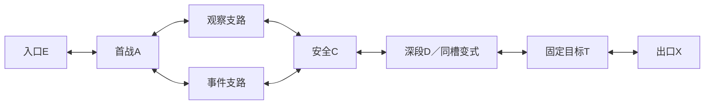

# 《火种计划：边境回响》地图、地形与路线

**0.9实现接续：** [运水事件闭环](专项/运水事件可玩闭环.md)已补入EV03暮汀接收与当前去向、EV09货物占位及交货；独立文本层同步普通人场景。地点光源元数据含藏身者无灯例外，实际光照与自主NPC移动仍未实现；下文标注0.8尚缺的相关记录以本条接续。

**八区联合布点已登记：** 每区两套拓扑模板，含事件、固定补给、真实服务目标和出口；见[JOINT-MAP-1.0](专项/八区事件补给与服务联合布点.md)。仍待灰盒与实际联合生成器验证。

TINDER-1.7内容基线＋MULTI-1.1现行远征结构。

**CIVILIAN-1.0站点语义：** 区域入口I、护运站和临时工棚只承担接驳、作业或短歇，不能据此在魔境建立永久免疫村落。长期安置在暮汀；安全撤离服务须明确“现场→已可用路径→I→既有转送→暮汀接收”的完整去向，不以到达I代替最终接收。服务人员按批次轮换，有实际工具和返程安排；高威胁区仅在有合理接应的作业点出现。八区网络、事件数量、回访和撤离成本不因此改变。详见[魔境普通人与边境生存](专项/魔境普通人与边境生存设定.md)；灰盒0.8仍采用原接收抽象，目的地记录待同步。
**TINDER-1.7内容基线＋MAP-CONT-1.0空间修订｜2026-10-26｜关卡与数据制作规格。** 本篇负责魔境区域、随机路线、同地接敌、照明、侵蚀暴露和静态棋盘；空间组织以[连续区域小地图与探索规则](专项/连续区域小地图与探索规则.md)及[连续地图合同](校验/连续区域地图合同.json)为准；地格与短途基线见[地图地形JSON](校验/地图地形.json)，敌人动作及任务胜负归[07](07_敌人与遭遇规格.md)，物资预算归[11](11_战利品装备与制造.md)。地图图标不是奖励或剧情完成证明。

**现行普通远征：MULTI-1.1。** 短途2区／中途3区／长途4区；取消四外围四内围，八区改为地理网络。每区仍是一张连续小地图。普通远征的新跨区、补给、侵蚀、费用、经验及共享收益以[多区域远征与八区网络](专项/多区域远征与八区网络.md)和[配置](校验/多区域远征配置.json)为准；下文旧单区数值仅作基线或固定任务参考，未实装。

## TINDER-1.7 当前内容池

八区各4组普通、2组精英及3张专属事件已写入；当前92条活动遭遇、52事件／156选项。原21组全域敌阵已退出抽样，原28事件保持原选择与后果。完整编队、24卡正文、现场制作及初始权重见[八区事件与怪物池补全](专项/八区事件与怪物池补全.md)。设计完成不代表运行时接入或平衡通过。

〔来源〕边境安全区、肉鸽魔境、四方魔将、深入环境侵蚀精神以及最终魔王城来自[大纲原设]；有限区域随机图、T3随行灯与原地交战、八棋盘七地形及固定坐标属于[沿用设计]；八区结构与名称、四章分配、危险区域暴露去重和终局专线属于[补全设计]。未声称已制作生成器、场景或完成真实通路体验验证。

〔本轮作者确认的补全〕管理员在训练运行期间受隔离协议约束，只接收批次统计，不能读取实时人格、私密任务物或旧人类授权片段，也不能直接改写人物、物件和路线。现实培养舱由独立的旧人类安全控制层管理，虚拟域最高权限不包含舱控、神经回接或生命支持授权；Agla接入的是这条独立授权链。上述权限边界并非PDF逐字原设，仍属未实装的文档规格。

## 一 固定的大区，变化的一趟路

暮汀边境镇是安全区。每次出发选择2／3／4区的远征长度与合法目标方向；每个区域各生成一张连续、有限的小地图。玩家沿真实道路与可走地形探索；敌群、事件对象、工作台、营地和任务地标分布在地图中。路线图负责显示已经发现的地点与连接，不是逐层点击传送的操作界面。

地图可包含支路、环路和局部开阔地；普通道路可回头。每个遭遇绑定当前场地的棋盘、地形和实际敌人；靠近接敌边界后先停步预览与部署，确认前可退出，正式开战后沿原撤退规则。战后回到同一现场继续行走，相邻敌群不自动合并。地图内部可技术分块，玩家的道路、位置、朝向与对象状态保持连续。

回访看到处理后的现场：清过敌不重生，事件选择含PASS保留，物品claim不重开。目标完成后正式返程前仍可回访；只有提前明示的具体剧情或地形理由才可限制回走。一个连续区域不等于必须清空全部据点，跳过可选内容不伪造战果或剧情事实。

新出发才新地图、新区域实例和野外锚；退出续玩、暂停、换阵、点灯、失败保存重试和回头都继续同一图。安全返程后旧激活记录可留作历史，但不能套到新`area_instance_id`点亮下一趟。城镇建筑、名册、装备、觉醒、程序片和关系不清除，普通胜利不重置世界。

训练隔离协议要求管理员只接收批次统计，不能在本趟中直接改写路线、人物、任务物或私密授权。现有地图随机性和捕获／独返按预签规则运行；候选可在既有权限和真实见证内学习。现实培养舱安全控制层与实验网络分开，旧授权不能由地图编辑、最高虚拟权限或普通制造材料伪造。

## 二 八区网络与远征长度

现行普通远征以短途2个不同区域、中途3区、长途4区组织，取消外围／内围与一一配对。八区名称、章节门槛、原生威胁和四将驻地保留，但地理相邻关系与出口按[多区域远征专项](专项/多区域远征与八区网络.md)读取。苇灯湿地连接多条方向；其他地区也互通，不要求每次经它。

每个区域是一张连续地图；本区回访保持现场。完成目标后使用北向或地形对应的目标出口，可扎营一次、选合法后继区域或撤离。跨区提交前明示本趟不能回旧区；末区出口直接提供返程。南侧入口仍允许提前撤离，不要求打完目标才能回城。

路线只走出发时已解锁地区，同趟不重复；下一出口必须能在剩余区数内到达预选目标。新章节事实途中取得不把本趟临时加长。每区试排3场主路战、至多1精英、3—4事件地点和1处固定补给；短／中／长完整路线对应6—8／9—12／12—16战。事件资格过滤后的实际卡数可能更少。

最终魔王与管理员仍使用FINAL_ROUTE专线，不是第九个随机区域，不接入普通2／3／4区流程。原格数据、原地接敌与战斗时序维持，数值与地图服务只按专项明确范围替换。

## 三 连续地图与旧短途参考

现行常规地图不再要求固定七层或按层访问，实体地点按可达空间与任务服务组织。下列RT2／RT3仅保留为旧短途预算和教程参考，不作为连续地图生成器。

旧短途主路7层锚：E入口、A首战、B分支、C安全、D深段、T目标、X出口。层数不是独立区域数或访问上限。危险侵蚀按实际危险区域身份计，不能把每个可见节点都偷偷当一次+5。

| 层 | RT2_OPTIONAL_ELITE | RT3_REPLACE_MID |
| --- | --- | --- |
| 0 E | 安全整备、任务及风险 | 同左 |
| 1 A | 普通战或替入单机制首遇 | 同左 |
| 2 B | 观察／生态分支；精英占预留第三战槽 | 情报／资源分支，不额外塞精英 |
| 3 C | 汇合、安全整备、可早返 | 同左 |
| 4 D | 资源／观察，不再加战 | 同一地点普通／精英二选一，共用MID槽 |
| 5 T | 固定目标战 | 同左 |
| 6 X | 归队预览、提交1行动日 | 同左 |

RT2不选精英2战，选了3战；RT3恒3战，普通／精英只是同一战斗槽的互斥预设。回到路口不能再打另一个版本。不同B、D非战支可回访，但随机事件仍每趟最多2张、各卡1次、全趟共享物资预算。可走路不代表增加第3张奖励卡；超出事件展示位的道路仍能作为观察或普通整备点。

图只说明普通道路双向和汇合关系；RT2可选精英占预留第三槽，RT3在D换强度。战斗一旦开始，不能沿图中箭头普通移动脱战，撤退仍按03当前拍加一追击拍处理。

生成先保证任务、出口和安全路径，再填支路；至少一条路不经精英，关键物与固定目标不靠稀有奖励，近战有合法接近格，新敌与新地形分开教学。最低合法六值普通兵的合理队伍须有基础主线解法；纯佣兵、少人英雄与混编使用同一通路，不读实际阵容临时降敌或换容易种子。

教学RT2_TUT01是固定布局和种子例外，供两战与真岔路教学，事实用ST-101/102，SC-101/102只作旧事务别名。救援、唯一物追回、四将追忆、定向人性委托、终局使用固定任务模板，不为凑7锚额外塞怪。追忆不复活魔将刷首奖；定向人性任务提供确定入口，但实际行动、因子和收益按09。

## 四 三层照明，互不代替

| 层 | 触发及范围 | 不授予的结果 |
| --- | --- | --- |
| 手持灯 | 普通行进自动照见附近原路，已走路留低亮轮廓 | 不独立侦察、不穿墙全知、不改技能索敌，不点一次走一步 |
| 接敌扩光 | 真正发现当前地点原有敌人，临时显露本地整块棋盘 | 不刷怪、不把全图远敌拉入、不伤害或削弱敌人 |
| 区域照明锚 | 到达预设锚，非战斗主动点亮所属有限区域，本趟持续 | 不传送、回血、降侵蚀、清敌、领奖、恢复技能或赋予觉醒 |

**有人事件的现场光源（用户确认）：** 除藏身者可无灯外，有人类NPC公开活动的事件地点必须自带实际发光的提灯、挂灯、车船灯、工作灯或火盆，覆盖人物与必要交互物，不仅依靠玩家随队灯。它是场景局部照明，不另设区域解锁层、不替代照明锚，不降低侵蚀或提供恢复。光线遵守遮挡，藏身者不强制用灯，可通过非光线线索与近处队伍照明发现；看到亮处不提前公开事件详情。需要光源的有人现场待处理时保持照明，撤离后按灯随人走或固定灯保留的实际状态保存，回访、读档不重置。具体布置与验收见[普通人设定2.1节](专项/魔境普通人与边境生存设定.md)。本项为待实现的场景规格。

节点状态分`UNSEEN`未知、`REVEALED_UNVISITED`看见未到、`VISITED`实际到达。照见不能冒充到访，到访不能冒充claim、清场或事件选择。镜头越墙不揭后台，常亮区域仍遵守实体遮挡；盘内全可读但近暖远暗、柔边、未知盘外保持黑，不用全白环境表现“看清”。格线平时收起，部署、危险、路径预览时局部显现。

基础照路、接敌整盘公开和点亮锚均不耗蓝、燃料、补给、钱晶、耐久、行动日或事件预览位，不新增护灯读条与灯具受击系统。2铜探路仍只买更早的远方完整详情，去重键为节点与详情；到战前必须知道的内容免费公开，早买的信息不因后来到场而退款。

主动点亮流程为到达预设锚→查看精确覆盖范围→点亮或取消→保存成功才显示常亮。`illumination_anchor_id`指环境物件，`stable_anchor`只是安全处理输入的位置，城镇归返锚是主角个人返回定位，三者不能混成全队传送。

点亮去重键含`expedition_id/illumination_anchor_id/area_instance_id/事务版本`；同批保存范围版本、`activation_receipt`、真实光域及局部可见增量。取消零写，失败留同一草案和最后已提交光域，不先亮再撤回业务。重复点亮只读取原回执。战斗、接敌过渡、待保存结果期间不能插入点亮事务。

本区常亮可让原物件与敌人轮廓可见，但未到仍标看见未到；远处看见敌人不启动远程战斗，也不直接给全盘细节。当前本地接敌才自动扩光。集合收光时若当前区已常亮，不能把它强制变回黑。离区和同趟续玩常亮保持，返城结束后不继承下一趟新锚。

教学可选点IA_TUT_C，仅覆盖AREA_TUT_FORK：A出口岔路局部、B_SUPPORT、B_MATERIAL和C；排除A整盘、D/T/X及相邻未知区。不点也可继续、回访和早返。它不新增节点、战斗、奖励或必做教程步骤。

## 五 阶段切换与精神暴露

| 阶段 | 可用输入 | 领域合同 |
| --- | --- | --- |
| 探索 | 选相邻出口、返回、真实事件、非战斗用物、整备、保存退出 | 同一travel_id保存位置、揭示、到访及首次危险区域暴露 |
| 接敌过渡 | 自动停步、警戒、扩光与主角退后；可跳过镜头、暂停、保存 | 保存encounter_id与目标阶段，续玩只补呈现，不重新造敌或写奖励 |
| 布阵 | 完整敌情、站位、朝向、姿态、目标、队列、合法补给；明确开战或取消 | 开战才锁battle_id，取消回接敌前安全锚，敌人仍未清、不追击不领奖 |
| 战斗／暂停 | 查看、暂停继续、变速、请求撤退、公开任务互动 | 完整拍边界保存同tick、占格、HP、动作、次数、RNG与终战倒计时 |
| 战后 | 保存结果后集合、收光；再选领奖、方案、继续或返程 | 人员、段收益、侵蚀和clear同ID提交；集合只消费结果，不重复结算 |

每个区域实例显式配置是否危险。固定任务按危险`area_instance_id`首次进入+5；MULTI普通远征改按每区域实例首次危险进入+5，详见专项；同趟回访0。仅照明、相机看见、预览或到安全邻点不加。一次实际战斗完成后仍在队者含预备：固定任务沿原+10，MULTI普通远征为+5；已安全护送走者不受后续战斗影响，重复结果页和续玩不再加。事件附加值先显示再确认。

0—39稳定、40—69紧绷、70—99动摇，后两档不暗改属性或AI；100失稳在下一非战斗检查退出部署，仍能带回和救援。地图不因失稳删人，不用“迷雾吞噬”动画直接判永久损失。安全归城−20，城镇休整1日−30，路上安全节点及灯锚不提供重复恢复。保存精神值与暴露、战斗和归城回执，不能靠回访叠惩罚或洗清。

侵蚀条和行前风险需说明当前队员能否继续，不把剧情里一句“他开始害怕”当未列数值。发生失稳后仍有原路早返和护送导航；主角独返不是把队员从危境一键传回。终战特殊格式化压力归07，不借地图迷雾另扣未声明的现实秒倒计时。

教程TUT01固定三个危险区域：AREA_TUT_ENTRY含E/A，AREA_TUT_FORK含B_SUPPORT、B_MATERIAL、C/D，AREA_TUT_ROOT含T/X。C是危险区内的安全站位，不另产生一次入区侵蚀；照明锚仅照其中部分地点，光域和精神暴露域分别保存。无额外事件增减、三域两战、起始0的完整随行生还者，归城前35、归城后15；预备是否参与当场经验另按实际部署，不与侵蚀收受者混同。

## 六 七类静态地形

棋盘7列9行，q=0…6、r=0…8。六邻格为D0(1,0)、D1(0,1)、D2(−1,1)、D3(−1,0)、D4(0,−1)、D5(1,−1)，距离`max(|Δq|,|Δr|,|Δq+Δr|)`。本场地形初始化后不改变，桥、高台和岸线都是既存场地。

| 地形ID | 移动及站立 | 射线与边界 |
| --- | --- | --- |
| GROUND平地 | 一次移动一邻格 | 不挡，无属性加成 |
| SHALLOW_WATER浅水 | 可站，进入后下一拍仅限制移动 | 不挡，无湿身附伤，不需专用靴 |
| DEEP_WATER深水 | 不可走不可站，两格移动也不能跨 | 不挡射线，是空隙不是水墙，始终保留普通陆／浅水路线 |
| LOW_OBSTACLE矮障 | 不可走不可站 | 普通平地直射受阻，合法高台或技能最多越一处，不拆障 |
| HIGH_OBSTACLE实墙 | 不可走不可站 | 阻挡需要视线动作，不能高台或贯枝穿过，无动态坍塌 |
| FIXED_BRIDGE既成桥 | 可走可站，与平地同速 | 不挡，不搭桥拆桥，不收桥杀敌 |
| HIGH_GROUND高台 | 可走可站，同平地速，无独立垂直层 | 源或目标在高台可越一矮障，不加射程、伤害、护甲、暴击闪避 |

默认己方部署r=0/1，敌模板r=5/6/7；可站格不自动开放战前敌后部署。部位、护军和生成候选用自己的预留锚，不能同格重叠；活单位占格，倒地标记不堵路。实墙不是敌人，茧也不能拆原生地形。地形不替角色旋盾，朝向和侧后仍按03。

### 浅水的一拍恢复

进入浅水当拍可移动站住，下一拍禁止自主移动但可合法普攻、治疗、盾或非位移技能，拍末清恢复，再下一拍正常移动。再进一块浅水再设一次，不累成无穷禁行。`movement_cost=2`仅表示一次进入加一拍移动恢复，不代表新行动点或金币。

例t1由(0,2)到(0,3)浅水，t2不移动可做非移动动作，t3到(0,4)平地，t4正常前进，离水不罚第二次。两格疾行遇首浅水即截断，不在同拍继续第二格，主动次数仍按起手消耗。强制推入水仍设恢复，不免疫推位；无合法落格按卡只处理原伤害，不加溺水撞墙处决。初始部署、新实例生成和原格复起不算入水移动，不能摆水里刷移动收益。

CO10涉水准备可在战斗外给本人预用。下一场首次实际自移或合法推入浅水消耗，免下一拍移动停顿，不增加本次步数、不越障穿人，仍在第一水格结束两格移动。整场未触发结束清除，战斗暂停不能补药；不用它也必须有有限拍数可接近的普通近战路。

## 七 射线和地形预览

看见敌人不表示动作打得到。探索可见、战斗全盘公开、动作射线和图鉴已见分别判；付费情报也不能给隔墙攻击许可。射线从轴转立方`x=q,y=−q−r,z=r`，按距离等分插值，最近整数半值远离零，修正最大误差轴使和为0，等误差按x/y/z顺序。预览画实际格链，命中时不换有利边界线。

两端格不算中间障碍。实墙挡所有需要视线动作；矮障最多越1处，取技能穿障与实际高台许可较大者，不能相加穿2处。近击仍不能穿矮障或实墙，两格长兵不等于隔墙刺。深水不挡合法投射，但不可走过。折线分段检查，整次不每段重置穿障额度；范围特效不能默认绕墙。

| 例 | 结果 |
| --- | --- |
| OPEN (1,2)→(4,2) | 地形射线合法，仍验射程、目标、机会 |
| DUAL_FLANK (2,2)→(4,2) | (3,2)实墙挡，高台与贯枝也不穿 |
| DRY_ISLAND (3,2)→(3,5) | 深水不挡射线，但步行不能走这条直线 |
| MIRROR_COURT (2,2)→(2,4) | 一矮障挡普通直射，有合法一次穿障才过 |
| MIRROR_COURT (1,4)→(3,2) | 源高台可越(2,3)一矮障，近击仍不能刺墙 |

友军可穿射线、首敌截获与护卫归03。攻击不留下破口，地图续玩不会新开通道。初见地形在布阵前免费演示：浅水“进入→移动恢复→再走”，深水绕行、矮障和实墙的区别、高台只越一薄障。演示不额外战斗、日期、奖励，也不等于已经见过某敌技能。

## 八 按地点使用多种棋盘

现行边界采用[多形状战场边界与部署](专项/多形状战场边界与部署.md)：场地可为矩形、近正方形或正六边形，不再固定7×9。八模板的新格表、部署与地形已接入独立灰盒0.3，同一区域可按不同战斗地点使用多种形状。

以下表格及原地图JSON保留为旧7×9内容基线，不直接作为新几何；旧数据未列格均GROUND、展开63格。board_id继续用于主题和地点绑定，新几何另按专项读取；`blocked`只代表不可站立，不等于不透光；深水、矮障、实墙必须分开查询。

| board_id／布局 | 地形覆盖(q,r) | 用途 |
| --- | --- | --- |
| OPEN开阔前庭 | 全平地 | 轴线、侧接、投射、单机制教学的基础对照 |
| DOUBLE_BRIDGE双桥石隘 | 实墙(0,3)/(2,3)/(3,3)/(4,3)/(6,3)；桥(1,3)/(5,3)；浅水(0,2)/(2,2)/(4,2)/(6,2) | 双通路护线，两桥已经存在 |
| DRY_ISLAND浅湾干岛 | 深水(2,3)/(3,3)/(4,3)/(3,4)；浅水(1,3)/(5,3)/(2,4)/(4,4)/(1,4)/(5,4) | 两岸陆路接近、跨水射击 |
| DUAL_FLANK石脊双侧道 | 实墙(3,2)/(3,3)/(3,4)/(3,5) | 中线遮挡和两侧近击，MG01用盘 |
| SALT_CROSSING浅沟交叉口 | 浅水r=3整行及(3,2)/(3,4)；矮障(1,4)/(5,4)；高台(1,2)/(5,2) | 缓行和两侧射线，MG03用盘 |
| MIRROR_COURT旧镜台庭院 | 实墙(3,3)；矮障(2,3)/(4,3)；高台(1,2)/(5,2)/(1,4)/(5,4) | 高台越薄障、绕墙，MG02用盘；名字不自动偏折 |
| FORGE_CROSSING炉场交会坪 | 实墙(1,3)/(5,3)；矮障(2,4)/(4,4)；高台(0,4)/(6,4) | 中路与外缘、后场预留，MG04用盘，无环境灼烧 |
| CITADEL_RING王城环廊 | 实墙(2,3)/(3,3)/(4,3)；矮障(1,4)/(5,4)；高台(0,3)/(6,3) | 两侧接近核心，CH4两终战；同型环廊可用于普通堡垒/工场 |

普通六敌参考锚为(2,5)/(4,5)/(3,6)/(1,6)/(5,6)/(3,7)。首领模式核心(3,6)、部位(2,6)/(4,6)、护军(1,5)/(5,5)，与普通六敌模式分开，不把两套同时生成。首见单敌(3,6)，不放在DUAL_FLANK墙格(3,5)。己方参考六位(1,1)/(3,1)/(5,1)/(0,0)/(2,0)/(4,0)，可在合法部署区调整。

这些是几何参考而非强制阵容。敌方召援必须逐场确认空格、人数及预留预算，不能因为后场看似有空间免费加兵。JSON保留两条内部不重合步行见证及浅水恢复到达记录，它们是可重算制作输入，不替代完整战斗与友军争格验证。

## 九 四将、追忆与B的可达性

四将固定绑定：BATTLE-MG01/RG02/DUAL_FLANK；BATTLE-MG02/RG03/MIRROR_COURT；BATTLE-MG03/RG04/SALT_CROSSING；BATTLE-MG04/RG05/FORGE_CROSSING。每场完整敌卡和记忆窗口按07。地图保存DEFEATED与AWAKENED两回执，击败不开随机再生；未觉醒者在最终确认前有固定追忆入口，补做不重发首奖、钱、印或经验。

城镇定向委托能进入EV03/05/07/09/12/16/19/22/25/28的缺项行为。普通随机只决定偶遇，不让无穷刷图成为100因子的门槛。PASS或未完成交付可续办；已完成出卖永久关闭本卡保全，不能用定向任务反悔。按事件ID只第一次实际保全完成+10；已完成者只读。固定任务不得被最近两趟冷却或未知区域图标藏掉，也不把一个人性选项写成必须牺牲队员。

KS01来自镇长CH1档案，KS02为观测站Lv2的CH2解析，KS03为Lv3的CH3研究。固定任务目的地、返程和缺材料路径都可导航；必需程序片不放在稀有掉率、随机棋盘变式或英雄专属移动之后。Agla合成及实际携带由02/11登记，地图只读最终出发清单，不代替工坊扣料。

## 十 CH4固定终局专线

`FINAL_ROUTE`包含魔王城与管理员核心竞技场，CH4／TH5，使用CITADEL_RING固定几何；BATTLE-DEMON与BATTLE-ADMIN分别有真实阶段和同趟持久状态。它不是第九随机区，不会因为普通环廊被照亮就跳入终战。ST-401揭露后，ST-402明确归并进入C，或拒绝并保存RESISTANCE_CONFIRMED后继续；后者经ST-403魔王实际处理、DEMON_PROCESS_ENDED与竞争权柄继承回执，再进入ST-404维护争夺与格式化。只有候选进程真实结束才打开管理员直接维护窗口；普通败战和地区首领不会开启。

最终确认前可回城补四觉醒、观测站、工坊、十事件、三KS及Agla。确认页明确终战单向通路：主动关闭常规回城接入后本轮不能返回，败北按预签条款进入FIN-C；ST-401前不向角色泄露分身及回传后台；进入后退出续玩继续同阶段，不能以加载重回普通安全城镇购买钥匙。DEMON→ADMIN保留实际生命、已用技能、冷却与消耗品，按同一终战资源组续接，不因遭遇ID改变重置。终战中照明、镜头、暂停不重建敌阵，不免费恢复队员；任一阶段仍须有人类队员可行动，独剩虚拟伴兽不构成终战生还条件。

两战之间只安排一次`ADMIN_PREPARATION`：清除已败魔王的旧敌和召唤实例，将本趟幸存、可部署的原随队成员（包括原预备）放回r=0/1正常部署区，检查最多6人、原携行名单、出征／上场Cost和各格合法后才确认投影ADMIN(3,7)及护卫(1,6)/(5,6)。这次合法重排用于消除结束占格冲突，不生成新人、不取城镇库存、不回血、不重置技能／药品次数、冷却、复起标记或侵蚀，不增加跨区侵蚀及行动日。保存过渡阶段、幸存者快照与一次确认回执；恢复同次准备不重复刷出管理员，倒地或失稳者不会因换部署区重新就绪。

接入格(3,5)是GROUND上的非阻挡任务接口，地图不为它新增地形或独立占格单位。B需同一人类连续2拍接入并清除管理员与护卫。

第三阶段普通行动选择前先读取接入格。若(3,5)已有当前已部署且可行动的人类，他立即接任执行者，不要求原指定者先倒地；若为空，则由仍合法的战前指定者前往，指定者失能后按已部署可行动人类的稳定实例ID替补。执行者变更清零未完成进度；接入须同一executor_id连续两逻辑拍各花一次普通动作，不能与移动、普攻或技能并发。已有不可取消的起手、维持或到期释放先完成，不能为接入强行退款；受伤但仍站立且连续完成接入不清零。

若占格者为虚拟伴兽，断网任务优先要求它用一次普通移动退到合法相邻空格，不瞬移、不对穿、不额外行动。先选没有已锁下一拍危险的落格，再按(q,r)升序；没有安全空格但有其他合法空格时，显示风险后按同序选择。只有本拍能合法移动、没有已占用动作的单位才能让位。

若伴兽周围无合法空格，按当前拍初格图寻找从(3,5)经可行动友方占格到最近可站空格的最短六邻路径；不穿敌、墙、深水或无移动资格单位。同长先选安全终点，再按终点(q,r)及整条坐标序列字典序。建立可恢复的疏通队列，从空格端向内逐拍移动一名友军，每次只走一个真实邻格并占该人的普通动作，空位传到伴兽旁后它才移出。已起手或受阻者先履行原规则，该路径暂不可执行就选下一合法链；每拍重验敌人、落格和预约，失效重算，不把旧占格当可穿。疏通期间这些单位不另攻击或施技，其他人的正常合法动作照常，24拍倒计时继续。若暂时没有合法链，只等待战斗真实变化并显示堵塞原因，不仅因己方占格立即判C；倒计时耗尽等既有失败条件照常生效。

格式化计时属于finale全局状态，不依附仍存活的ADMIN实体。每拍合法伤害结算后，若ADMIN本拍由35%以上跨到不高于35%，包括直接归零，且本轮尚未初始化格式化，先提交第三阶段、24拍计时和所选路线目标，再裁决生还、失败及胜利。A、B均走此顺序；B同时启用接入目标，A没有两拍接入要求。初始化当拍不扣预算，从下一逻辑拍递减；核心归零不取消计时或接入，不再初始化第二份24拍，也不因退出续玩增加预算。B核心先归零时继续全局目标，直到接入完成并满足胜利，或既有失败条件发生。

占格、排队疏通、executor_id与两拍进度属于真实战斗状态，按下述地图JSON接口合同保存；具体敌招和伤害仍归07。

完成B断网撤销实验网络权限而保留地下培养舱生命支持，虚拟碎裂不等于切断培养舱电源。A击败管理员后仅接管虚拟域、保全虚拟幸存者并停止收割，不能取得独立现实舱控授权或在该轮清理后重造Agla；C为预签的终战败北或全名册不可恢复的覆灭；地图仅按01分流完美B与不完美B，不额外发明路线。已永久失去的普通队员不会因退出场景或终局镜头被重新生成。

## 十一 保存、数据和检查边界

新地图保存`expedition_id/route_instance_id/map_seed`、各area实例、进出口映射、节点连线、board和敌阵、战斗槽变式、事件与claim、已知详情、照明回执、危险暴露回执及精神值。旅行同一`travel_id`一次提交位置、揭示、到访与首次侵蚀；保存失败不先扣精神，恢复时也不能再扣。业务阶段和呈现阶段分开，接敌或集合动画中退出只恢复呈现到已提交阶段。

地图JSON的`schema_version=2`只是本次文档数据结构变化，设计版本TINDER-1.2；不宣称旧产品或旧原型存档已经迁移。保留八盘cells、静态通路与射线示例，重写regions并补`chapter_unlock_contract/mental_erosion_contract/memory_revisit_contract/directed_humanity_access_contract/finale_route_contract`。新数据的普通胜利无世界重置，CH5及旧主线场景不再生效。

静态检查应重算每图实际有效格集合、地形一致、部署／敌锚不重叠、入口到目标出口连通、近战有接近格、普通／精英共享槽、区域与四将盘绑定一致、任务与返程可达、(3,5)接入格合法以及旧叙事字段清除。旧版本通路报告和抽象战斗报告只作历史，不能直接给新四将和管理员盖通过章。引擎中还须验实际尺度、光域遮挡、路径回访、存续、侵蚀去重、键鼠等价与低动态过渡；本轮文案不代替这些实机证据。

## TINDER-1.2终局路线的立场门禁

FINAL_ROUTE的ST-401后到达ST-402；询问或未确认留在该场景。明确接受人格收益归并并确认后，直接提交PROFIT_ASSIMILATION的FIN-C，不生成BATTLE-DEMON或BATTLE-ADMIN。拒绝并保存RESISTANCE_CONFIRMED才开放魔王战；实际击败魔王承接CANDIDATE_AUTHORITY_INHERITED并开启管理员阶段。既有A/B出发快照只锁准备与战斗目标，不阻止玩家后来明确选择C。原八盘地形、两战耗损和B接入路径不改，主角的对等权限不生成可穿墙通路或额外部署单位。

## TINDER-1.3：护送与交付位置

EV03/07/28须由原第二或第四层事件节点挂接真实固定安全接收站与既有撤离服务；验证接收链接后才纳入随机候选，不能仅靠一段文本宣称已经送到。地图不兼容时可用出发前公示的独立短委托，绝不往当前地图追加节点、路段或战斗。EV05/19用同一撤离服务结束本趟并在镇内医舍收件。

EV09以原回收车2份材料额度运输，先预留后领物，原路线安全归城实际收件才完成。败战时由沿线安全站暂存待交付物，原案件回到待续办；不变出新副本或把承诺记成功。EV25保持站内现成认领桌、物件和固定认领员的现场交付，不占材料额度；其机会成本改为放弃大额交易。

跨图或改走定向入口仍读取同一案件；已出卖不重刷，已保全不再卖。所有接收物与人物为事件剧情对象，不增可招募人数，不占战斗棋盘，不复活已正式损失的队员。

## TINDER-1.4专项：内容池与随机规则

地图候选应按棋盘/敌阵/任务服务兼容关系联合处理，完整分布与有限重试次数仍待确定。普通非战支可回访，因此路径条数不能直接作为有效策略数量；本轮不添加走路消耗或每步侵蚀。详见[联合审查与随机规则框架](专项/内容池与随机规则框架.md)及[结构化登记](校验/随机规则框架.json)。
