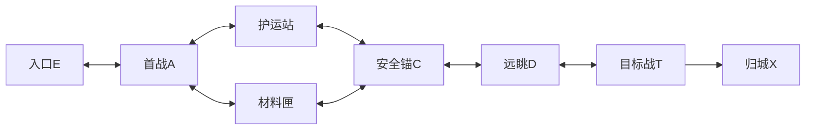

# 《火种计划：边境回响》首次远征教程与样片脚本

**灰盒0.42接入状态（2026-10-28）：** 已接自然开局所需的固定侦路灰盒：八地点/两战、建议部署可选、两支路可回访、护运站灯具与支持、材料/方案/装备箱、主动调查、安全归城和真实失败。已实际跑通两战与续档；未完成镜头、字幕演出、扩光可视化、音画与12—20分钟体验验收，不把功能闭环当作完整样片。详见[整模块验证记录](../../原型/火种计划_远征灰盒/验证记录_v042.md)。下文较早状态属于历史记录。

**TINDER-1.7｜2026-10-26｜可供制作的剧本与交互规格；0.42已接CLI基本流程，完整样片未实装、未体验验收。** 首玩从主角染血独返开始，以带着自己培养的新兵回城结束。玩家此时相信主角是前代唯一生还的指挥官；他能感受到记忆断层和敌人的熟悉反应，却不知道自己是初生魔王创造的分身。具体主线真值见[01](01_世界叙事与主线.md)，机器流程见[首次远征数据](样片/首次远征流程.json)。

来源：[大纲原设]是独返、怀疑、重建招募、初探魔境与异常指令；[沿用设计]是17步骤、两场真实战斗、8人出征/6人部署、T3原地扩光与回访、收益和事务骨架；[补全设计]是所有分镜、台词、时长、具体人名、事件编排与侵蚀演示。[待验证]包括自动战斗胜率、12—20分钟首玩目标、声音画面和新手理解。

## 1 这趟必须交给玩家的体验

城镇里的人并不因为主角归来就自动信任他。任务让他有机会认识新队员，再带队完成一件可验证的小任务；玩家可以跳过交谈，剧情不因此假定双方已经建立信任。首战中的怪物像听懂过主角的口令；这条异样只留下疑问，不立刻用全知旁白替玩家解释。归城时优先点名和处理伤员，物资只是下一趟能否更有把握的条件。

目标首玩12—20分钟，慢读、暂停与探索可更久，熟悉者可更短；不通过延长待机凑时长。连续演出预算约100—130秒，其他时间留给真实操作。4—6分钟展示片只作剪辑目标，不能把跳切变成游戏自动跳过选择。1倍速统一以0.5秒呈现一逻辑拍，2倍/4倍速按同一逻辑状态推进。字幕、教学提示与镜头可以暂停模拟并独立延长，玩家读完再继续；至少一整拍预警的规则不意味着只给0.5秒阅读说明。动画表现与墙钟等待不改变逻辑冷却、次数或结果。

教程教六个决定：带谁、怎么站、先走哪里、是否回头、是否继续、把战果用在哪。英雄招募、十六书、制造、复杂地形、正式吞并过程与终局都留待后续。灯随行开雾，接敌在原地扩光；它不攻击、不治疗、不生成新路。普通失败主角可以独返，队友的去向必须照实结算。

## 2 任务、场地与收益合同

| 项目 | 规格 |
| --- | --- |
| 任务 | TUT01“灰栎边道侦路”，CH1 / RG01 |
| 主线 | ST-000独返；ST-101委任；ST-102侦路交付；ST-103只给异常伏笔 |
| 路线 | RT2_TUT01固定布局/种子作为教学例外，正式普通远征每趟随机 |
| 战斗A | INTRO-EN01，OPEN盘，一只拟态丛 |
| 战斗T | TUT01-ROOT，另一地点的OPEN盘，两只拟态丛 |
| 主线目标 | 两处真实威胁清除，安全归城交存调查；不要求无伤或强制受击 |
| 委托报酬 | A携行6铜；T再携行10铜2结晶；安全归城共16铜2结晶 |
| 两个固定事件 | 护运站一次12私盾/提前敌情；材料匣一次2材料，均可拒绝，可都去 |
| 目标箱 | 可拒绝的一次RB-GEAR，CACHE-D0品质70%/28%/2%，固定数值 |
| 明确未得 | 四执念物、KS片、Agla、英雄印、首胜许可、魔王胜利或终局事实 |
| 完成时点 | T胜利只记威胁清除；安全总提交才记ST-102交付和RG01同区后续调查入口，CH2仍需ST-104 |

拟态丛是会行动的敌人实例，地面和树木装饰是静态场景。击败敌人不改格型、岸线或连线，不把整片魔境清成空白。第一章玩家只叫它拟态丛，不在字幕中写“人工智能训练残留”。胜利后出现的远处影子只登记可观察现象，不进入DEMON终战。

只走一支最短七锚，补走另一支共八个不同锚，往返不重刷战斗、选择、收益、侵蚀或日期。两场OPEN只复用格型，位置、敌实例和battle_id各自不同；不能切到同一竞技场假装同地。照明锚只保存本趟本区域，下一趟新图和野外锚不继承；同趟保存续玩仍回到原地图和光照状态。

## 3 名册、站位、控制与风险

第一次接受委任配发3盾S01、3近S02、2弓S03，共8名真实实例，按06正常六值区间随机，初始种子保存后不重抽，不收招募费。已受任的重试继续原名册，不补发因失败而失去的人。建议八人同行、六人上场；玩家点“采用建议”才填入阵型，合法少带或改阵不被教程拦住。

| 实例别名 | 推荐(q,r) | 姿态 | 说明 |
| --- | --- | --- | --- |
| INIT-S01-A | (2,1) | 守位 | 正面保护 |
| INIT-S01-B | (4,1) | 守位 | 第二接近线 |
| INIT-S02-A | (0,1) | 迂回 | 左侧接近 |
| INIT-S02-B | (6,1) | 迂回 | 右侧接近 |
| INIT-S03-A | (2,0) | 避险 | 后排射线 |
| INIT-S03-B | (4,0) | 避险 | 后排射线 |
| 余下盾/近各一 | 预备，无棋盘格 | 不行动 | 安全锚可真实换入 |

首战敌位(3,6)，目标战敌位(2,5)/(4,5)，初始化时绝不同时生成三只。全盘7列9行、63格，林景装饰在格外，不能用可见树暗中挡射线。战前免费显示合法必需敌情，强技至少一整拍预警；战中允许暂停、查看、变速、撤退，不允许换装和用消耗品，暂停也同样禁用。

每趟只在归城总提交推进1行动日。示例D0出发、D1结算；实际存档用真实d→d+1，不因重试教程退回D0。阅读、演出跳过、暂停、来回走路不推进日历。出发清单说明捕获截止C+3或宽松C+5，主角独返不带回被捕者；到期时先处理同趟成功救援，再处理仍被捕者正式吞并。

## 4 17个步骤的分镜、操作与完成边界

### S00 染血独返与重新委任

**画面与表演。** 北门响起迟缓的敲门声。镜头先看见地上的血，再看见主角的脸。沈砚展开盖有阵亡印的旧名册，停在最后一行。主角说不出完整经过，只能描述一个让他先走的声音。镇民没有立刻鼓掌；有人往门后退了一步。

**玩家操作。** 读完或跳过开场后，自行接受委任。第一次接受才初始化60铜/12结晶/6补给与8名真实士兵，跳过演出不重复配发。

**完成与边界。** ST-000与ST-101只记已发生的独返和委任；不把疑问答案写给玩家。 这一步的演出播放记录与世界事务分开：跳过台词仍保留合法操作，重复进入不重发已提交结果。

### S01 秦姨交付行囊与手灯

**画面与表演。** 秦姨逐个念出新兵姓名，桌上每一份行囊都有对应标签。手灯放在边上，光圈只照着地图和人手。队员整理扣带时，主角下意识说出旧队的点名顺序，又停住。

**玩家操作。** 核对真实名册、补给预览与灯的作用；不要求点击一百次物品。自动随行照路，不花费举灯次数或照路资源。

**完成与边界。** 旧称呼仅为断层伏笔；新兵不因此获得前代身份。 这一步的演出播放记录与世界事务分开：跳过台词仍保留合法操作，重复进入不重发已提交结果。

### S02 选择带谁与怎样站

**画面与表演。** 编队桌同时给出八个同行位和六个上场位，预备者靠桌后站着。每个单位Cost和六属性可查。采用建议后仍可更换、少带或关闭引导。

**玩家操作。** 建议3盾3近2弓同行，2盾2近2弓上场；出征Cost8、部署Cost6。实际合法即能出发，不用固定推荐阵型做门锁。

**完成与边界。** 所有字幕读取真实实例；失去某人后的重试不生成同名替身。 这一步的演出播放记录与世界事务分开：跳过台词仍保留合法操作，重复进入不重发已提交结果。

### S03 从北门出发

**画面与表演。** 城门在队伍身后关上。镜头回到固定等距视角；路面连续接到灰栎边道，不用切黑跳到一块无关棋盘。出发清单最后显示捕获期限与共享包风险。

**玩家操作。** 确认基础消耗1补给，可选额外转包1补给；显示实际出发日d与预计结算d+1。取消无扣款。确认后种子、敌人和奖励槽只生成一次。

**完成与边界。** 这是普通侦路，按预签规则结算独返与真实队员去向；不适用后续终战单向边界，也不表现管理员临时夺权。 这一步的演出播放记录与世界事务分开：跳过台词仍保留合法操作，重复进入不重发已提交结果。

### S04 沿旧路看见脚印

**画面与表演。** 灯随队伍移动，照出先前藏在暗处的石路与脚印。未走到的远处仍暗，地形不是临时生成给玩家看的。敌人的枝条在草边停顿了一下，像在分辨主角手势。

**玩家操作。** 使用明确路径出口或实际移动输入前进；第一次进入危险区域，对当时成员登记+5侵蚀，回头不再加。

**完成与边界。** 不设按L举灯或付费看路线；光不攻击、不回血、不替换地形。 这一步的演出播放记录与世界事务分开：跳过台词仍保留合法操作，重复进入不重发已提交结果。

### S05 首战：它听懂过号令

**画面与表演。** 接敌原地扩光，完整OPEN盘在同一段旧路上显出。单个拟态丛先向侧翼偏了半拍，随后回到实际战斗动作。队员问它是否认得手势，主角没有答案。

**玩家操作。** 进入免费公开敌情和部署；开战后看预警、按需暂停查看再继续。敌技至少一整拍预警，不强迫玩家挨一下证明学会。

**完成与边界。** INTRO-EN01使用真实单位六值，无特供弱敌、无强制胜利。 这一步的演出播放记录与世界事务分开：跳过台词仍保留合法操作，重复进入不重发已提交结果。

### S06 战果先放在携行账

**画面与表演。** 击败实际敌人后，落叶重新落回路面；地图上的已清标记固定下来。委托报酬6铜显示“携行”，没有立刻飘进城镇库存。队员展开捡到的战术笔记。

**玩家操作。** 从PL01/PL02/PL05选一或拒绝；当前最多3方案。记真实战斗结果、每名资格成员侵蚀+10与对应物资，不提前给经验或升等级。

**完成与边界。** 战斗结算与奖励重入同ID只执行一次。 这一步的演出播放记录与世界事务分开：跳过台词仍保留合法操作，重复进入不重发已提交结果。

### S07 先走哪条岔路

**画面与表演。** 旧路牌左右都留着磨亮的边。护运站有安全护持，材料匣在另一边。实际同行者说两边都能回走。远处未知部分仍保持黑暗。

**玩家操作。** 玩家选先去的支路；路线不做永久二选一，未先走支路不淡出锁死。普通来回不重刷事件、敌人、材料或日期。首次到达B_SUPPORT或B_MATERIAL便进入AREA_TUT_FORK，登记一次+5侵蚀；之后去另一支、C或D不再加同区域进入值。

**完成与边界。** 地图回访与事件互斥选择分开：回得去，不等于已领的卡能再选。 这一步的演出播放记录与世界事务分开：跳过台词仍保留合法操作，重复进入不重发已提交结果。

### S08A 护运站的登记簿

**画面与表演。** 站内只剩一张预先写好的护持服务单。灯下的旧盾架有使用痕迹，留言说明只能给一名真实上场者一次护持。没有远程NPC假装现场指挥。

**玩家操作。** 选护持时为一名合法站立实例登记下场12私盾，并提前展示目标处已锁敌情；也可PASS。仅此一次，不给库存护盾道具。

**完成与边界。** 若在目标胜利后才回访，过期护持不再发，仍可读留言。 这一步的演出播放记录与世界事务分开：跳过台词仍保留合法操作，重复进入不重发已提交结果。

### S08B 材料匣里的封签

**画面与表演。** 封签写着回收日期和所属仓库。队员打开匣，拿出两份已登记材料；空匣继续留在原处。秦姨曾说过，材料要真的带回才能做药。

**玩家操作。** 领取一次RB-MAT2或PASS，扣本趟共享材料2额度；教程不另发铜、书、应召印或永久属性。

**完成与边界。** 材料先携行，普通失败丢失；同趟再看只显示封签和原回执。 这一步的演出播放记录与世界事务分开：跳过台词仍保留合法操作，重复进入不重发已提交结果。

### S09 在安全锚前停一停

**画面与表演。** 队伍到达可休息的固定站位。旧照明座可被点亮，照清本区域已经存在的道路；队员之间能看见彼此的脸。主角第一次主动请每个人回答点名。

**玩家操作。** 可整理装备、用合法补给、更换真实预备、选择早返；可选激活本趟照明锚，不花费额外一天。AREA_TUT_FORK的首次进入已在到达B支路时登记+5；此处只读取该回执，不再次加侵蚀。

**完成与边界。** 锚是照明记忆，不能洗掉侵蚀、治疗伤势、清敌或继承到下一张新图。 这一步的演出播放记录与世界事务分开：跳过台词仍保留合法操作，重复进入不重发已提交结果。

### S10 远眺根口

**画面与表演。** 远处两团枝影在同一片旧路边活动。镜头允许玩家看清敌人数与预警方式后回到队伍，不把可跳过的推镜当成固定等待。

**玩家操作。** 展示两只已锁拟态丛与OPEN格型，可返回整备或继续；护运站只是更早给出同一情报，不决定是否能看见必要敌情。

**完成与边界。** 未进入战斗不扣药、不跳日；观察不是ST-102完成条件。 这一步的演出播放记录与世界事务分开：跳过台词仍保留合法操作，重复进入不重发已提交结果。

### S11 目标战：把安排执行完

**画面与表演。** 接敌后仍在根口原地扩光。两个拟态丛各有真实实例和起手预警，不因为镜头切过就重置冷却。队员的行动来自此前保存的姿态、目标与技能顺序。

**玩家操作。** 真实部署后自动战斗，允许暂停/查看/变速/撤退；战斗中与暂停都禁用药品和换装。同拍合法伤害按03一起结算。

**完成与边界。** TUT01-ROOT胜利只记root_threat_cleared、携行10铜2结晶；未归城不写已交付。 这一步的演出播放记录与世界事务分开：跳过台词仍保留合法操作，重复进入不重发已提交结果。

### S12 远处那道没有靠近的影子

**画面与表演。** 战场安静后，远处出现一个不完整的人形轮廓。声音说“这个号令，我见过”，主角转向时，它已经淡入阴影。队员只能确认自己看见过影子。

**玩家操作。** 演出可跳过；不生成魔王战、不开放攻击按钮、不授予任何击败魔王或城镇或名册重置。先记录可观察异常，再让玩家继续。

**完成与边界。** DEMON的身份、分身、培养舱与管理员全部留到各自固定揭露。 这一步的演出播放记录与世界事务分开：跳过台词仍保留合法操作，重复进入不重发已提交结果。

### S13 旧巡路队的装备箱

**画面与表演。** 箱子放在路侧，原巡路队的记号仍在。当前队员建议先核对物件再搬。画面不把领取装备写成剥取敌人器官。

**玩家操作。** 可领一次RB-GEAR或拒绝；先看家族池与CACHE-D0的70/28/2品质表，再按11领取固定模板。非战斗可合法装备。

**完成与边界。** 未装新物与共享包一起可能丢失；穿上后也不获得主角独返保护。 这一步的演出播放记录与世界事务分开：跳过台词仍保留合法操作，重复进入不重发已提交结果。

### S14 带着真实结果回城

**画面与表演。** 城门内的镜头先看人数，再看战利品。沈砚问“回来了几个人”，不按预先脚本回答八个。伤员、空位和被捕记录都进入同一份归城清单。

**玩家操作。** 安全归城一次提交实际人员、携行款物、未用额外补给、日历d+1、经验与ST-102交付；早返没有目标款和交付。

**完成与边界。** 先处理期限内救援成功，再处理到期吞并；本趟新伤不在同一结算立减一天。 这一步的演出播放记录与世界事务分开：跳过台词仍保留合法操作，重复进入不重发已提交结果。

### S15 先决定下一趟缺什么

**画面与表演。** 秦姨把材料摆上库房桌。沈砚等着防线修复计划，许苇带来旧队名册的封套。镜头停在新兵本人日志与旧名册并排的位置。

**玩家操作。** 玩家可装备一件物品、选择医舍或遗迹观测站建设，也可暂不花钱。建设下单不耗日，实际进度等后续合法行动结算；查看异常记录不强制出发。

**完成与边界。** 标准样片止于重新经营；后续真相、救援战、四将和终局均只留入口，不假称已制作。 这一步的演出播放记录与世界事务分开：跳过台词仍保留合法操作，重复进入不重发已提交结果。

## 5 对白库与说话人条件

下列是本片完整对白。TD编号与JSON的`dialogues`及各cue一一引用。正式字幕使用真实姓名，普通兵发言不自动成为英雄。实际同行队员不可行动、已捕获、已永久损失或不在场时，由另一真实可行动者说通用句，或转为环境字幕；不得让画外死者讲话。秦姨、沈砚、许苇只在实际城镇或明确纸面记录中发声，不做无来源的远程实时指挥。

| ID | 说话人 | 台词 |
| --- | --- | --- |
| TD001 | 沈砚 | 门外送来的名册上，你们已经全员阵亡。 |
| TD002 | 主角 | 我记得有人让我先走。再往后的事……接不上了。 |
| TD003 | 沈砚 | 那就先别急着解释。把还在这里的人带好。 |
| TD004 | 秦姨 | 八个人，都是刚登记的新兵。我给他们备了行囊，名字得由你亲自记。 |
| TD005 | 秦姨 | 路没变得更短。只是旧哨站没人照看了，先去看清能不能走。 |
| TD006 | 秦姨 | 灯会跟着你们，照清眼前的路。它不会替谁挡箭。 |
| TD007 | 实际同行队员 | 脚印还在。有人往那边走过，也有人往回跑。 |
| TD008 | 实际同行队员 | 它刚才……是不是在等你的手势？ |
| TD009 | 主角 | 先按训练站稳。看清它要打哪里。 |
| TD010 | 实际同行队员 | 两条旧路都能走。先去哪边，还能回来。 |
| TD011 | 护运站留言 | 需要护持，就在这里登记。材料匣在另一边，不领也能继续。 |
| TD012 | 实际同行队员 | 这盏旧灯点亮后，这一片就看得清了。到下一趟，得重新找路。 |
| TD013 | 实际同行队员 | 前面有两处动静，都是刚才见过的那种。我们可以先整备。 |
| TD014 | 主角 | 盾在前，侧边的人等它露出空当。 |
| TD015 | 远处不明声音 | 这个号令，我见过。 |
| TD016 | 主角 | 谁在那边？ |
| TD017 | 实际同行队员 | 只有那道影子。它没有过来。 |
| TD018 | 实际同行队员 | 这里有旧巡路队的箱子，封条还在。带不带，先把数目记清。 |
| TD019 | 沈砚 | 回来了几个人？ |
| TD020 | 主角 | 按名册核对。物资放这边，伤员先去医舍。 |
| TD021 | 沈砚 | 路可以慢慢收回来。人不能写成下一批就有。 |
| TD022 | 秦姨 | 你们带回的只算这一趟。先看看他们还缺什么。 |
| TD023 | 许苇 | 那份旧名册我找到了。等你准备好，我们一起看。 |
| TD024 | 秦姨 | 你回来了。其他人在哪？ |
| TD025 | 主角 | 把最后的位置记下来。能去找的，现在就准备。 |
| TD026 | 秦姨 | 我会照实登记。还没找到的人，不算已经回家。 |
| TD027 | 实际同行队员 | 到这里先歇一会儿。要不要继续，由我们看清以后再定。 |
| TD028 | 沈砚 | 这次带回了前段的消息。根口还没查完，等人准备好再去。 |
| TD029 | 许苇 | 你说它在号令之前动了？我只记现象，先不替你下结论。 |
| TD030 | 秦姨 | 东西放进仓库，才算真正带回来。把每个人穿着什么也记上。 |
| TD031 | 实际同行队员 | 我们在这儿。点到谁，就由谁回答。 |
| TD032 | 主角 | 我不知道那次发生了什么。这一趟，我会把每个人的去向记清。 |

TD015—017仅在目标战真实胜利后播放，影子身份不在字幕署名为魔王。TD024—026用于普通战败独返；TD028用于安全早返且ST-102未交付，不能套用完整成功祝贺。TD029只在玩家实际见过指令异常后说，不提前替未发生的事件造证据。点名与归来人数读取实际名册，不能固定回答八人。

## 6 精神侵蚀与情感连续

[补全设计]本片三个危险区域为AREA_TUT_ENTRY、AREA_TUT_FORK、AREA_TUT_ROOT。每名队员首次进入各区域+5，重复走过和保存再进不加；每次战斗结算仍在队的成员+10。无额外事件侵蚀、完整走过三域和两战的存活同行者在归城前为35，安全归城-20后为15。初始为0；预备也是真实同行者，是否受区域侵蚀按实际在队记录，战斗结算增量只对该结算仍在队者一次处理。最后数值须从成员实际行程计算，不给所有人强行写35。

0—39稳定、40—69紧绷只反馈、70—99动摇提示风险，100在下一次非战斗检查退出可部署名单，仍可带回或救援，不自动死亡吞并。本片不强迫达到70，不暗加命中或伤害惩罚。城镇休整1行动日-30由02统一执行。精神提示围绕本人可见反应和日志，不把新兵写成用来攒非理性因子的筹码；本教程固定两事件不发十卡中的任何10点。

## 7 失败、早返与再次尝试

安全早返是合法决定。A后回城可带回实际已得6铜和已经领取的合法支路物，未打T就没有10铜2结晶、目标箱或ST-102交付。没有新增目标款就不能说“任务圆满完成”。以后接续教程使用实际日历与剩余名册，重新出发新expedition_id、仍用固定教学布局；已完成教程的周目只读回看，不通过重播重新领奖。

普通战败执行真实人员结算：能被实体带回者、失联者、被捕者和正式损失者分别显示。主角独自出现在北门，城镇、既有建筑、名册、已知任务和其他长期结果继续存在，当前携行钱物按失败丢失。不能用一张“再来一次”把八名新兵复原。若仍有被捕者，搜救所显示真实截止和入口；后续救援战不是本片两场战斗的一部分。

一场部署者全倒不立刻等于整份名册人格全部不可恢复。尚有预备、其他可用队员、受伤可休整者或仍能救援的人时，不触发彻底覆灭C；不得为了显示一次失败演出就抹掉所有在镇人员。本教程只有01定义的全名册不可恢复且无救援对象才进入C；后续终局另有魔王/管理员战败、格式化失败与ST-402明确趋利归并三类原因。终战风险在其自身出发前另行明确，不偷偷套到第一场教学。ST-401之前角色只会说“跨过终战边界便不能返回”，不懂主角分身、旧脑体或AI回传；完整机制由ST-401揭露。进入终战的主动单向承诺也不能倒写成管理员在训练中临时收走独返。

## 8 账本样例与幂等保存

前提：新档60铜/12公共结晶/6补给，无出发前购买建设，基础1补给消耗、额外1转包；一趟结算1日。未用额外补给安全返库，实际用掉不返。装备、材料、经验和人员另列，不折成铜晶。数值示例不证明推荐阵型必胜。

| 结果 | 归城铜 | 公共结晶 | 补给 | 日期 | ST-102 |
| --- | --- | --- | --- | --- | --- |
| 完整成功，额外补给未用 | 76 | 14 | 5 | D1 | 已交付 |
| 完整成功，额外补给已用 | 76 | 14 | 4 | D1 | 已交付 |
| A后安全早返，补给未用 | 66 | 12 | 5 | D1 | 未交付 |
| 首战前撤退成功，补给未用 | 60 | 12 | 5 | D1 | 未交付 |
| 普通战败、共享包丢失 | 60 | 12 | 4 | D1 | 未交付 |

安全归城且实际参战符合条件者每趟1经验，多场不叠成2；从未部署的预备不获参战经验，Lv1→2需2经验，首趟不免费升级。完整成功后可选医舍Lv1下单20铜4结晶，余56铜10晶；或观测站Lv1下单16铜4结晶，余60铜10晶。建设尚需2进度，首趟已过的行动不追溯抵工期，下单本身不推进日历。

流程数据保留24种回执：初始配发、委任、灯具核验、出发、脚印观察、战斗结果、区段报酬、方案决定、路径行进、事件展示、事件选项、物品领取、安全锚决定、远眺观察、目标清除、演出播放、装备箱决定、归城总提交、ST102交付、建设下单、装备转移、引导步骤、开雾与照明锚激活。每种事务以同一存档/远征/对象稳定ID提交，世界结果、引导进度与演出播放进度分开，跳过引导不跳过真实世界规则。

关窗、保存失败、重复点击、加载到某cue之前、从远处返回原位置，均不能重复扣基础补给、再生初始兵、刷新敌人、重抽品质、重发方案或多推进一天。同趟地图、已访问区、已清敌、事件选择、已领箱、光照锚与侵蚀进入回执均持久保存。归城提交中的中断要恢复同一结果，不能出现人员已回而钱物未入库的半结果。

## 9 资产、镜头与声音交接

结构数据沿用21个资产需求组、20个cue，表示要制作的需求而非已经交付的资产。最小场景包括暮汀北门/编队桌/仓库桌，连续灰栎边道、两处原地OPEN战斗空间、双支路与安全锚；角色包括主角、实际士兵、沈砚/秦姨/许苇、拟态丛和不具名远影。旧名册、灯、封签、装备箱等小物必须能被看清，不用大量昂贵特效代替信息。

北门演出先听门闩与衣物摩擦，保持低声，镇民的怀疑通过距离而不是高声辱骂。旅途保留脚步、枝叶、远处哨音；指令异常使用短暂节奏错位，不用系统报错字体提前剧透。战斗动作声对齐实际起手和命中，预警依可见逻辑拍显示，暂停时声音和字幕不继续带走必要信息。远影只给一个短句，不露出管理员UI或培养舱画面。

等距镜头保持队伍和道路方向，教程可推近但可跳过且不剥夺合法退出/设置；照明扩光用区域渐变解释同地点完整战场，不能黑屏搬到另一个地图。UI在720p与1080p都需验证文字、费用、捕获风险、部署Cost和实际归来人数可读。字幕可调大小，颜色之外还用图形/文字区分威胁、路径与状态。

## 10 验收与交付边界

静态核对17步骤、24回执、21资产组、20cue、32完整对白及其引用；原有47个验收合同保留事务边界，基础火种叙事/侵蚀7条，TINDER-1.1再加3条知识与权限边界合同，共57条。它们是待执行验收输入，不是57条引擎测试已经通过。关键反例包括：跳过开场不重发名册；新兵替换不冒充旧队友；普通失败不世界重置；远影不生成魔王胜利；回访不重复加侵蚀；未在场者不说话；完整成功账与早返账不同。

实际验证必须用真实可运行版本完成两场战斗、一次早返、一次失败和续玩；核对动作、路径、预警、视听、日历、捕获期限与账本，再邀请陌生玩家尝试。询问玩家是否理解灯、预设战斗、共享包风险及“主角回城不等于同伴无事”，并观察是否在归城后记住至少一名当前队员。12—20分钟、胜率、情感效果和双分辨率舒适度均尚未验证。返回[总入口](README.md)。

## 11 TINDER-1.1知识与权限交接

管理员的训练隔离和独立现实人类授权属于[本轮作者确认的补全]。本片只让人物看到真实队员、旧物、异常动作和独返后果；不把作者用的后台合同直接放进早期字幕。32条对白仍保持原信息上限，主角只承认失忆，不承认自己是另一个人格。影子短句也不替代ST-401的明确身份揭露。

普通捕获、期限和独返由实验部署时已签定规则自动执行；管理员训练中不读取实时人格、个人任务物或私密授权，也不在看见抵抗时临时改人、改物、改路。只有DEMON_PROCESS_ENDED正常终局回执打开直接维护窗口；全名册不可恢复或终战败北的C是预签终止条款，不能把尚未开放的管理员写成提前下场。

进入魔王城才有预先提示的单向边界：玩家主动封闭常规回城接入，以免对方循来路追踪突入目标；ST-401前只用人物能理解的“跨过后无法返回”表达。分身、旧脑体和回传机制仍在ST-401解释。本教程不触发该边界，也不通过提前讲AI后台来解释第一场普通失败。上述只是文档规则与验收输入，未实装或体验验证。

## 12 TINDER-1.2自主选择边界

点名、回城检查与救援是可见流程，不自动证明玩家关心队员。教程没有趋利结局判定：领材料、选收益、早返、未交谈都不生成归并立场。候选只评价已见动作；它的基础出场句不称赞未发生的照顾。终局ST-402的明确选择在身份揭露后发生，不放入首玩，也不由教程自动预选。

计数说明：教程只读INTRO-EN01与独立TUT01-ROOT附录；样片来源备注中的65为旧目录规模。1.7活动目录为92，教程行为与附录计数归属均不变。
