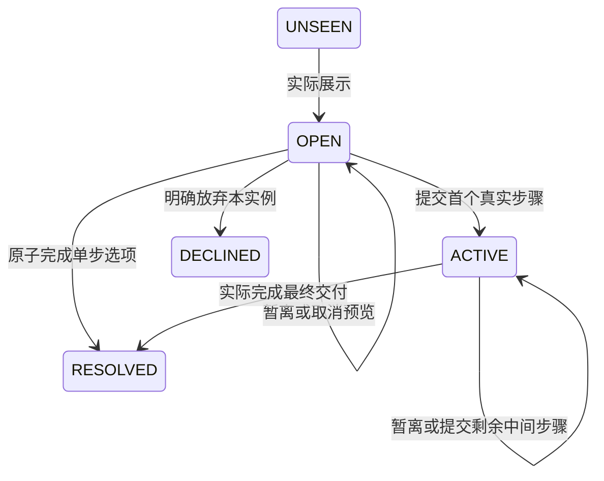

# 事件暂离、回访与结算规则

**0.9实现接续：** [运水事件闭环](运水事件可玩闭环.md)已补入EV03暮汀接收与当前去向、EV09货物占位及交货；独立文本层同步普通人场景。地点光源元数据含藏身者无灯例外，实际光照与自主NPC移动仍未实现；下文标注0.8尚缺的相关记录以本条接续。

REVISIT-1.0 · 2026-10-27 · [用户确认] 未完成事件可以暂时离开，回到原地点继续处理；原料、背包、补给时机由玩家自行权衡。[补全设计] 下列状态、提交边界与界面文案。仅完成文档与离线规则样例，未实装。

**CIVILIAN-1.0叙事补充：** 回访保障事件继续办理，不保障NPC永远住在危险现场。同趟未离区时保持既有回访；跨趟按同一人的最后处境、实际照护／接洽方和剩余义务续接，已经转移者不得重新摆成原受困状态。护运接驳不是永久安置，完整保全要落到暮汀接收或本卡规定的实际权利／物件交割。见[普通人设定第4—5节](魔境普通人与边境生存设定.md)。这一补充尚未写入灰盒NPC去向记录。

## 适用范围与本轮修订

适用于新出发的SHORT／MEDIUM／LONG普通多区域远征，覆盖现有60张事件，不增加事件数、奖励额度或额外行动日。结构化登记见[事件回访与结算合同](../校验/事件回访与结算合同.json)。固定教程和特殊任务沿其明确模板；既有存档沿已保存的规则版本，已完成、已明确放弃或按旧规则PASS关闭的实例不自动重开。

新普通远征里的“继续前进”“暂不接手”“按原路线继续”统一表达为**暂时离开**。旧数据中的PASS在此范围内映射为SUSPEND，不再写最终放弃回执。关闭窗口、取消尚未提交的确认页、走出交互范围也采用这个行为。原七份内容基线与扩展事件数据保留原字节，由本合同明确覆盖离开语义。

**明确放弃**为独立操作，文案“本趟不再处理此事”，说明会关闭本实例后才提交。它不占新的奖励选项、不改卡池权重；仅对尚无已提交行动的事件开放。人性案件的本趟放弃仍不等于出卖，不关闭原定向续办入口。

资源不足、满背包、当前无治疗需求都可以使选项暂不可用。允许玩家探索、战斗、整理背包后回来；不为保证两项立即可选而自动换卡、补原料或提供额外补偿。

## 状态与现场访问分开保存

| 事件状态（内部标识） | 含义 | 返回时处理 |
| --- | --- | --- |
| 未展示 UNSEEN | 地点可能已标在地图上，但尚未展示卡片 | 首次实际展示后成为待处理；只看地图图标不计事件历史 |
| 待处理 OPEN | 已展示，尚无已提交行动；可以缺材料或缺容量 | 原卡、原奖励候选保留，重新核对当前条件 |
| 进行中 ACTIVE | 首个真实步骤已提交，已绑定选项和进度 | 从剩余步骤继续；不能改领另一分支，也不能重新支付已完成步骤 |
| 已完成 RESOLVED | 最终结果及回执已经提交 | 展示结果；重复确认返回旧回执，不再次扣费或发奖 |
| 本趟放弃 DECLINED | 在待处理状态明确放弃本实例 | 展示放弃结果；同趟不重开，原人性案件另按其状态续办 |

暂离是操作，不另造一个“未做／已做”状态：OPEN暂离仍为OPEN，ACTIVE暂离仍为ACTIVE。预览选项和打开方案三选一界面属于草稿，不因点击了第一层按钮就进入ACTIVE。

现场访问另外保存LOCAL／SEALED。提交单向跨区出口、归城或本趟结束后，原区域SEALED；旧实例保留进度与回执，但不能走回交互。已在途中护送或运输的人性任务可沿原接收流程继续，不能因为场景封存就抹掉人、货物或已发生的成本。

## 按实际行动保存进度

### 单步选择：准备不扣费，确认一起结算

制作、领取、交易、恢复、记录、侦察、改路等单步结果在最终确认时重新检查条件，将**真实费用、效果、库存变化、预算领取记录和最终回执一次提交**。材料不足、容量不足、恢复无收益、服务目标失效或保存失败，均不提交这一步，也不把事件关闭。

- EV30等8个制作服务：可以打开配方后暂离，找到原料再回棚制作；不预扣材料，不虚构制作工期或中途加工进度。制作完成与消耗材料同次提交。
- EV53／57／59等拾获成品：背包满时先保留现场物品。玩家自行整理或使用物品后回来领取；不会自动用掉奖励腾位。领取后再丢弃，也不恢复领取资格。
- EV54：满血时可以留下休息机会，受伤后回访。两种恢复仍共用整趟一次额度；无正收益不扣次数，已使用不能靠暂离刷新。
- EV55：伤害和材料同次提交，不能先取得材料，再靠离开逃掉生命代价；失败不扣血。确认时重新检查所选队员仍可承受代价。
- EV58／60：CO10或4材料只在实际成交时扣除；预览、缺货、暂离不扣。交易后不返还已占领取额度。
- 原方案三选一：候选及必要的装备品质等随机结果按原种子锁定；关闭预览保留相同候选，不能重抽。确认选用和明确替换才完成；本轮明确将“本趟不领取这份方案”作为显式拒领，会完成该选择且不再开放互斥奖励，与关闭预览分开。没有可应用的新方案又未明确拒领时，保持未提交并说明原因，不得把零变化自动记作领取或放弃。

只有有真实持续动作的事件进入ACTIVE，不能为每张卡凭空添加多阶段任务。

### EV04：两处拓片的实际进度

两座钟仍使用联合布点中的同一事件实例。选拓片并实际取得第一份后，保存对应钟的步骤回执，绑定PRIMARY；可以离开，在同一区域返回另一座钟继续。重复触碰第一座钟不产生第二份进度，不得改领铜币分支。

两份都实际完成时，才按原选项一次提交NOTE-EV04与原+5侵蚀；第一份不提前结算最终记录或奖励。两座钟的顺序自由。仅浏览说明、尚未取得任何拓片时，仍可回到OPEN选择其他分支。跨区后不补齐第二份，不伪造完成。

这是对原“两份拓片”与两处实物交互的进度补全，不新增战斗、日期、奖励或主线事实。

### 人性事件：选择现场与案件义务分离

| 方式／事件 | 首次提交与继续方式 | 暂离、跨区和失败边界 |
| --- | --- | --- |
| LOCAL：EV12／16／22／25 | 在实际见证者或收件人处原子交割；确认前可以暂离 | 未交割不记保全；EV25仍为现场认领，不增加2材料运输占位 |
| ESCORT：EV03／07／28 | 真实选派护送者并离队后保存派遣回执；实际接收后完成。也可走原全队返城分支 | 离开现场不召回派出者、不恢复其装备可用性；未收件保持待办，不提前发因子 |
| RETURN：EV05／19 | 确认前可暂离；确认实际执行后立即沿安全返城与医舍接收流程办理 | 不把已承诺的紧急返程改成“继续清图后再交”；未成功接收不伪造完成 |
| CARGO：EV09 | 实际装载时登记原2份未用材料额度占用，绑定保全；携带至真实接收处 | 区内暂离与跨区不卸货、不释放额度；同趟续办不重复占用。运输失败沿原托管／待办处理 |

案件状态OPEN／PROTECTION_PENDING／PROTECTED／EXPLOITED与地图事件实例分开。暂离、放弃本趟接手、封存地图、运输失败均不会自动写成出卖或保全。已派遣或装载后，泛用“放弃”不能撤销义务、退还成本或重新开放出卖；原续办系统按已有案件、人员与货物记录处理。

跨远征续办沿原章节门槛、定向入口和实际可用人手办理。前一趟的领取预算不带入新趟；仍需装载的货物在新趟占新额度，不能复制旧货物、旧护送者或重复取得终态收益。同一趟对同一义务反复操作只读已有派遣／载货回执。

原区域是案件来源及联络关系，不要求同一个受困者跨趟仍站在同一座棚里。固定续办需要显示当前接洽地点与尚未解决的义务；若已有人实际完成转送，不能继续收取一遍已完成的护送代价，也不能把别人的完成虚记为玩家的保全成果。急救与正式治疗、临时照护与解除追索分别表达；无倒计时的案件不得使用“再晚一刻必死”的永久定格场景。人物去向变化只在明确行动或结算边界记录，不随阅读、暂停或现实离线推进。

原巨额交易、永久后果和实际交割后+10均保持。玩家前台只显示具体人物、货物与去向，不显示内部案件状态、人格、系统或因子术语。

## 条件变化由玩家承担

回访只保留事件，不冻结整个世界。侦察绑定的B2已被探索、改路绑定的B1已揭示或开始战斗，对应选项保持失效；其余合法选择仍可处理，不能生成另一个目标补位。单步提交仍以当前队伍、材料、容量和场景事实为准。

“现在做不了”与“已经失去机会”分开说明：

- “缺少配方所需材料，可以之后回来。”
- “携行袋已满，整理后再来领取。”
- “这处敌阵已被探明，无需再打听。”
- “此处战斗已开始，无法再改变交战路线。”

全部实质选项暂时不可用时保留OPEN及原实例，显示具体原因和“暂时离开”；不能自动写DECLINED。已经不可逆失效的行动也不会因再次打开而恢复；允许保留该地点的现场记录，直到玩家明确放弃或离区封存，不承诺一定能完成。

区内回走不额外加行动日或步数侵蚀，沿原危险地段与战斗回执规则处理真实风险。

## 跨区出口、预算与冷却

跨区确认前汇总**已知且未办完**的地点，允许取消出口操作返回处理。提示示例：“离开后本趟无法返回。已知有2处待处理、1处进行中的调查。”不揭示尚未发现的事件。继续携带的护送／货运义务另列，不混同为已经失败的现场事件。提交出口与封存原区同次保存，失败不封区、不重复扎营或结算。

归城按原流程处理实际携带物资与接收服务；实际收到人、货、药物的回执才能完成案件。普通未完成事件不跨远征保留同一现场，下一趟按新图正常抽样，普通卡不因近期出现而排除或降权。人性未交割案件由既有定向续办承接。

暂离、放弃、失效、封存都不释放出发时为互斥选项预留的额度去增发其他奖励，也不追加目标材料。预算预留与实际领取分开记：未领取不记作已获物资，已支付、已领取和载货占用则依原回执保留。回访不能让另一个地点抢走已锁选项的额度。

首次实际展示卡片时记录一次“本趟已展示”；同实例回访不新增事件数、地点数或历史次数。实际展示、进度和选项与存档事务一起记录；下一次出发仅用已结束普通远征的历史判断后续联动资格，跨区不滚动窗口。普通卡不再因这份历史排除或降权。暂离或放弃不删除已展示记录，也不算完成选择。见[EVENT-LINK-1.0](近期事件联动与普通事件复现.md)。

## 保存与回执边界

保存区域实例、事件实例、规则版本、状态、已展示标记、已锁候选、已选分支、各步骤回执、已付成本、已占额度、案件关联和最终回执。关闭后读取这些记录，不调用抽样器。这里只规定文档中的事务要求，尚未证明正式存档文件的原子性。

对同一提交的重试先查回执，再看当前条件：已经制作成功后材料不足、已经治疗后满血，都不能把旧成功误报为未做并重复发奖。不同选项的提交到达已完成实例时只返回原结果，不允许另一分支。多阶段动作以独立步骤键去重；提交失败只退回该步骤前的有效快照，不能抹掉以前已成功的步骤。

验收包括材料不足后返回、满背包后返回、先战斗后回访、两钟分次完成、护送派遣与接收、运输跨区、明确放弃、冷却去重、重复提交和保存失败。见[离线校核脚本](../校验/check_event_revisit.py)及[逐情景结果](../校验/事件回访校核结果.json)。它们验证声明的状态与账本反例，不模拟60张事件的全部玩法或真实存档。

本轮登记60卡，按49张单步普通事件、1张含分步拓片的普通事件、10张人性事件区分；EV04的回收铜币分支仍为单步。28个具名验收情景覆盖上述边界及数据完整性，具体通过情况以结果文件为准。事务样例的简化账本数值仅用于检查是否重扣、重发，不定义新配方或新数值。此前CHOICE-1.0报告保留修订时点的输入哈希，只证明奖励预生成与配比，不能代替本轮回访语义验收。

修订前内容见[10份快照清单](../../../历史材料/文案归档/火种计划_REVISIT-1.0_事件回访修订前_20261027/快照哈希.json)。下一项转向代表队伍完整远征的战损、补给与材料收入；可回访是否值得绕路、顺序取舍是否有趣，仍需连续地图实际游玩验证。
