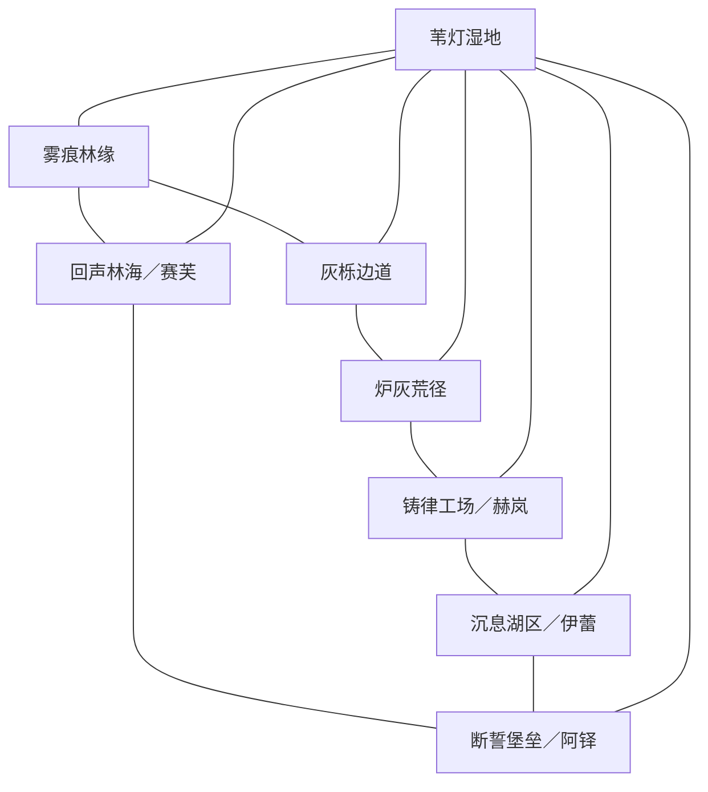

# 多区域远征与八区网络

**档位接入0.30：** [远征档位与长期挑战](远征档位与长期挑战.md)已接D0／D1／D2，出发选已开放档位，长度仍为2／3／4区。起始底线试验值为1／2／4，与地区下限和逐区成长取最大值；每区最多一场有限协作编队覆盖，不增加必经战、不削固定补给。D0／D1长途原有3件装备／2本书额度保留，D2短中途也提高到3件／2本；其余沿现有共享预算。完整高档池与正式平衡待补。

**深入成长修订（DEPTH-GROWTH-1.0，2026-10-28）：** [远征深入与敌人数值成长](远征深入与敌人数值成长.md)将普通远征改为地区威胁下限＋逐区递增：首区L＝地区下限，后区L＝max(前区L＋1，地区下限)。基础面板不是固定实战面板；同区回访不涨级，固定剧情战仍用专门参数。现由灰盒0.26独立运行层接入；冻结配置保留旧基线，平衡后置。

**2026-10-27规则覆盖：** [EVENT-LINK-1.0](近期事件联动与普通事件复现.md)已取消普通事件的跨趟冷却与近期降权。下文涉及两趟排除、0.25回补和旧容量测试的内容保留作当时方案记录；现行普通卡正常复现，历史用于可选后续。同趟唯一、现场结算与人性案件终态继续有效。

> 事件交互接续：[REVISIT-1.0暂离、回访与结算](事件暂离回访与结算规则.md)。新普通远征PASS为暂离；明确放弃、已完成与已提交进度分别保存。

> 抽样接续：[JOINT-SAMPLE-1.0联合抽样验收](联合抽样验收样例与失败边界.md)已完成离线参考模型、25个边界情景与36组种子样例。奖励预留已由[CHOICE-1.0](奖励预留与事件配比优化.md)接续：事件选项优先，可选目标材料后排，原额度不增；不等于运行时生成器或真实空间已验收。

> 布点接续：[JOINT-MAP-1.0八区联合布点](八区事件补给与服务联合布点.md)已登记16套模板、共同棋盘与服务接收绑定，并补出全八区一致分配见证；后续验证联合抽样与真实灰盒。下文早期诊断保留其证据时点。

MULTI-1.1 · 2026-10-26 · TINDER-1.7内容基线上的现行远征结构。设计已登记，未接入运行时或完成平衡。

**[用户确认] 短途经过2个区域，中途3个区域，长途4个区域；取消四外围、四内围的配置。** 一个区域仍是一张连续小地图，区域之间通过明确出口衔接。八区总数与已有名称保留；四魔将留在原驻地，但不再据此划出“内围”。

[补全设计／待试玩] 下列网络连线、每区内容密度、补给、侵蚀、初始收益和跨区规则。它们是配合已确认结构的首版参数，不冒称全部数值已获作者逐项确认。权威数据为[多区域远征配置](../校验/多区域远征配置.json)；[世界分布图](../样图/八区网络与远征长度_样图02.png)与[灰栎边道出口修订图](../样图/灰栎边道_连续小地图_样图02.png)用于空间评审。

## 关卡目标

让一轮构筑有多张区域地图可用：途中取得、调整并继续检验方案，带着实际损耗选择深入或撤离。跨区是同一趟远征的推进，不是连续领取几次回城奖励。区域选择保持随机候选与分支，玩家无需按预定顺序走完八区。

## 机制设计

### 三种长度

| 类型 | 不同区域数 | 战斗试排总量 | 事件地点试排 | 区内固定补给 | 区际营地 | 出发补给消耗 |
| --- | ---: | ---: | ---: | ---: | ---: | ---: |
| 短途 | 2 | 6—8 | 6—8 | 2 | 1 | 2 |
| 中途 | 3 | 9—12 | 9—12 | 3 | 2 | 3 |
| 长途 | 4 | 12—16 | 12—16 | 4 | 3 | 4 |

战斗按每区2场主路普通战＋1场目标战＋至多1场可选精英计算，完整通关最少3战／区。事件每区先安排3处基础地点，联合分配有余量才增加第4处，不与补给点混算；出发时基础3处必须能匹配不同的合法普通卡，不能靠人性卡或前路切换卡凑底数。章节、服务和近期普通卡回补均须纳入分配；基础不足则该布局不能放行。进入后玩家可能先用掉服务或探索目标，因此实际有效选项可以减少，只保留余下合法选项或现场后续，不复制卡片。提前撤离可以实际少打、少逛；表格不是强迫清图，也不是保证每趟抽满事件。

首次教程、救援、追回、定向人性短委托、追忆与终局仍有固定任务模板，不把这些专项任务称作“普通短途远征”。普通短途从完成ST-102后按2区规则选择，避免教程阶段只开放一张图却无法凑两区。

### 重排八区分布

八区组成有交叉连接的地理网络。苇灯湿地是通路较多的交汇地，其他方向也可互通，不必每趟经过它。连线是可生成跨区出口的地理许可，不是玩家点一下便跨过整区的菜单。

| 区域 | 空间职责 | 相邻区域 | 当前原生威胁 | 魔将 |
| --- | --- | --- | --- | --- |
| RG01 灰栎边道 | 旧军道、哨棚与基础接敌 | RG06、RG07、RG08 | TH1 | 无固定魔将 |
| RG02 断誓堡垒 | 庭院、侧门与守军防线 | RG03、RG04、RG07 | TH2 | MG01 |
| RG03 回声林海 | 林海庭院与隐匿追猎 | RG02、RG06、RG07 | TH3 | MG02 |
| RG04 沉息湖区 | 湖岸疗所与回声堤道 | RG02、RG05、RG07 | TH4 | MG03 |
| RG05 铸律工场 | 检修通道、炉场与构件库 | RG04、RG07、RG08 | TH4 | MG04 |
| RG06 雾痕林缘 | 林缘空地、兽径与分路 | RG01、RG03、RG07 | TH1 | 无固定魔将 |
| RG07 苇灯湿地 | 岸路与渡口，连接多条探索方向 | RG01、RG02、RG03、RG04、RG05、RG06、RG08 | TH1 | 无固定魔将 |
| RG08 炉灰荒径 | 护运与回收道，连接军道和工场 | RG01、RG05、RG07 | TH1 | 无固定魔将 |

[DEPTH-GROWTH-1.0替代原规则] 上表原生威胁现在是地区最低威胁N。首区有效威胁L＝N；进入后续地区时L＝max(前区L＋1，本区N)，不会因走入原生低威胁区而降档。同区回访与可选战不增加深度。完整计算、快照及固定剧情战边界见[深入成长规则](远征深入与敌人数值成长.md)。原章节开放不变：RG01在ST-101；RG06/07/08在ST-102；RG02/03在ST-104；RG04/05在CH2_COMPLETE。满足条件可选择已解锁起始地区，无须先清所谓外围。新世界图展示全图供作者评审，玩家只看已知可达地区与不剧透的锁定提示。

### 出发、分支与区域出口

出发先选长度与目标地区，生成器只提供能恰好串起2／3／4个不同且已解锁区域的合法路线。起点也从可完成该长度与目标的候选中选；无合法路线时在扣费前说明原因，不能暗减为一张图。单趟不重复区域ID，不能在两个区域之间反复刷满“四区”。

本趟所有可选后续分支的地图、敌种、编队、事件、补给、奖励及种子在出发时锁定；成长规则版本也同时锁定。敌人实际面板按所选路线前缀推导的有效威胁L计算，跨区提交时冻结；尚未选择的分支不共用错误的固定属性缓存。每个区域实例由expedition_id＋region_id定位，选不同支路不会重摇同一地区。同一状态下，出口只列能在剩余区数内到达已选目标的相邻区域；若只有一条合法通路就如实显示，不伪造多选。揭示下一地区名称、公开威胁、剩余区数与已知补给机会，不提前显示所有遭遇结果。

每张地图有两种清晰出口：

- **入口撤离点**：非战斗时可沿可达道路退回，确认后结束整趟，不退已经消耗的出发补给。
- **区域目标出口**：完成本区目标后到达。非末区可扎营一次、选合法下一地区，或直接撤离；末区为最终返程出口，不凭空出现第五区。

区内回头与未清支路探索仍允许。跨区出口提交前明确提示“离开后本趟不能回到此区”，确认前列明已知未办事件并允许返回处理，确认后封存该区现场；不在不知情时强制单向，也不为补遗漏物重新生成旧区。退出续玩留在实际当前区。区域出口、扎营与战果的保存必须分清，任何保存失败都保留上次有效状态。

路线举例（须满足所涉章节）：短途灰栎→湿地；中途林缘→湿地→湖区；长途灰栎→林缘→林海→堡垒。ST-102后的早期四区也可组成林缘→灰栎→荒径→湿地的长途，不依赖未开放的魔将地区。例子不是固定通关顺序。

### 区内内容重排

每区采用一个连续主目标方向、至少一条事件／补给回环与一个可选危险支路。3场主路战只是首版密度，必须用实体地形与目标解释必经性；若实际能绕过，计数和预算也要改。目标战通常是本地普通据点，不意味着每张地图都有魔将。专门讨伐魔将时，以固定魔将战替换目标槽并遵循其专属参数，不能顺便再加一次普通目标战或刷首次奖励。

灰栎样图02保留桥头、北隘、旧哨塔3场主路战，保留东侧1场可选精英；原西侧B2改作已存在的回收地点，不再另加一场战。旧哨塔后明确标出跨区／返程出口，南入口仍可提前撤离。S1为区内固定补给，首场主路战后、第二场前可不经额外战斗到达；原S2改作纯整备地，不多发一份补给，区际营地放在目标出口处。

### 全程承接与构筑

HP、伤势、侵蚀、人员状态、携行物资、4份消耗品与预备占用、最多3个临时方案、学习／适应事实、事件结果与全部领取回执跨区承接。换区不回城、不补人、不入库，不清空临时构筑，不让已护送离队的人重新出现；城镇工坊和招募也不在营地开放。

普通技能次数原本以battle_id＋本人＋技能为键，新一场普通战按原单场次数规则初始化；这不是营地额外刷新。魔王→管理员仍使用连续终战资源组，本专项的补给与跨区恢复不能插入终局。

## 难度评估

### 固定补给与侵蚀首版参数

| 服务／消耗 | MULTI首版规则 | 限制 |
| --- | --- | --- |
| 区内固定补给 | 每区1次，随行存活且HP>0者恢复最大生命30% | 向下取整，存在正恢复时最低1；不超上限、不复活、不造可带回药品；无人受益不耗次数 |
| 区际营地 | 每个非最终区域出口1次，同上恢复30%生命，并降侵蚀15 | 不治疗永久伤势；本趟边界回执去重，查看／读档不重用；不消耗额外行动日 |
| 入区暴露 | 首次实际进入该区域危险地带，侵蚀+5 | 每区域实例一次；不再为同图每个地段叠加 |
| 战后侵蚀 | 每次实际战果+5 | 仅新MULTI普通远征替换旧+10；预备与安全护送离队规则沿用 |
| 安全归城 | 侵蚀−20 | 整趟一次，非每区一次 |
| 自带补给与消耗品 | 沿原携行、费用与使用规则 | 不由跨区补满；原制造配方和4份上限不变 |

区内补给须在首场主路战后、第二场主路战前有可达支路，并在第二场前给出方向提示。取用不能要求另打精英、付费、接受事件交易或出卖人性；玩家可跳过或在离区前回访。只检查“地图上有一个补给点”不足以放行。

营地允许随队、仍存活且HP>0的侵蚀100人员接受降侵蚀，之后能否部署仍验伤势等条件；被俘、失联或永久损失者不能被营地远程治疗。最终区域不另给离区营地，直接选择返城；中途撤离可使用已经实际到达的非末区出口营地，不能领取后回头重复再领。

从侵蚀0出发、无事件增减、全打可选战且每个边界营地均使用，短／中／长返城前为35／45／55，返城后15／25／35。只打主路的返城前为25／30／35。计算仅核对规则是否自洽，不证明战斗伤害、补给强度或完整远征已经平衡；高起始侵蚀、事件代价和放弃营地会改变结果。

固定任务和FINAL_ROUTE保留原侵蚀合同。不能把这次降侵蚀规则套回所有历史任务，更不能根据当前队伍私改敌人强度。长流程优先测试低储备队伍、绕过事件、拒绝全部人性交易以及跳过可选精英的可行性。

## 奖励配置

全部数字为初始配平方案。跨区只增加已声明的可赚额度，不自动发满：

| 整趟上限／来源 | 短途2区 | 中途3区 | 长途4区 |
| --- | ---: | ---: | ---: |
| 装备最多 | 2 | 2 | 3 |
| 技能书最多 | 1 | 1 | 2 |
| 材料D0／D1／D2 | 8／12／16 | 12／18／24 | 16／24／32 |
| 普通事件额外铜／公共结晶 | 16／2 | 24／3 | 32／4 |
| 主路完整完成的委托铜／公共结晶 | 32／4 | 48／6 | 64／8 |
| 真实部署且安全归城者经验最多 | 2 | 3 | 4 |

CHOICE-1.0补充：目标额外材料在事件全部开放选项与外部承诺预留之后，按剩余额度出发前锁定0或2份；并非每区固定必掉2材料。剩余预算限制需作者复核，不直接作为面向玩家的内部额度提示。其他战斗掉落仍需接入完整掉落表。

每个实际完成区域目标记16铜＋2公共结晶待带回委托额；每场自选精英实际胜利另记原8铜＋2晶增量，每区最多1场。装备、材料、事件铜等各分类共享整趟上限，领取位置预分配，不能进入新区就清零已用数。品质表、地区材料权重与道德交易独立一次性账保持。事件展示多不意味着物资无限，多出的观察和选择应能改变信息、路线、加工或构筑，不全是同额箱子。

经验按本人实际部署参与过战斗且完成目标的区域计，每区1点，必须最终安全归城才入账；未完成的当前区域不额外给经验。安全早返只结算已经完成区域和实际携行物，不补未去区域的额度；普通失败沿原携行收益与人员搜救规则，不因上一地区已完成就把钱偷偷存进城镇。

暂保留整趟统一1行动日，跨区不另推救援期限、城镇施工或装备订单；符合旧工单条件的整趟实际行动最多推进1次，不因四张图推进4次。出发基础通用补给按区数2／3／4消耗，途中缩短旅程不退。出发页必须显示这条日期规则及预期收益来源。长度对经验、经济和救援选择的影响要在实测中比较，不能据此宣称长途永远更优。

## 事件去重与生成审计

原52卡的章节、地区、知识、服务与案件门槛保持，另按[早期四区普通事件扩展](早期四区普通事件扩池.md)合并EV53—EV60，当前为60卡（50普通、10人性）。新增成品拾获与事件休整按扩展额度结算，不能扩大旧材料、铜晶或携行上限。全趟同事件ID最多一次；近期历史按两次完整远征结算计，跨区不滚动清空。优先投放两趟内未见普通卡；若不足以填入已锁定事件位置，允许近期普通卡以原权重的1/4参与回补，仍须全部章节、地区与服务条件。这是扩长远征后的明确冷却例外，不适用于人性卡，不允许同趟重复。定向未交割人性案件整趟最多1项，替换原事件位置；已保全／出卖的案件不可换区重做。同趟各区联合分配候选，先预留定向案件与专属服务卡，避免第一地区耗尽后续所需共享卡。基础3处回补后仍不足，则重新选用通过内容校核的出发布局；第4处无额外合法候选就不生成。进入后的服务失效可以变为现场后续，不承诺填满12—16张独立奖励卡。

MULTI-1.1增加两项联合约束：前路切换事件的两个候选敌阵只能占用同一个未揭示普通战斗槽，其余两场主路战排除这两个ID；侦察事件须绑定另一处真实未知目标。以RG01为例，切换槽预留N01／N02，另两槽使用N03和N04；不满足条件就不投该服务卡。灰栎样图02原已使用N01和N02，因此不额外塞入EV31。多分支出发必须使用一致的地区实例，验证每条可选路径都无重复卡；逐条路径分别能匹配只是必要条件，不能冒充整个分支生成器已通过。

玩家交互开窗和确认提交前均复核服务、目标状态、配方材料、背包与奖励余额。目标已揭示／已开战则保持原敌阵，失效的改路选项置灰并用现场语言解释；侦察无未知目标同理。其他合法选项与暂时离开保留；全部实质选项暂不可用时保留原事件及未提交状态，显示条件与原因，可回访重检。不可逆失效不恢复、无支付、无奖励、无重抽。已交割事件直接返回原回执。只有实际展示过卡片才计入近期历史，同实例回访只计一次展示；已完成或明确放弃的地点保持终态，关闭窗口不等于关闭地点，不能靠暂离反复重摇。此规则允许先探图再遇事件，不要求玩家遵循作者的预定顺序。

承载数值、条件性缺口和收益比较见[完整远征承载校核](多区域远征耗损与事件承载校核.md)。这是纸面审计，不是战斗模拟或完成平衡。

生成器应输出全部合法区域序列、可选下一地区、每区事件有效候选与剔除原因、已预分配奖励及补给次数。无四区合法路线、无实际接收站、普通敌阵空池或预算不成立时，出发前阻止该配置，不偷偷换地区、降区数或忽略冷却。随机框架的初始敌阵／事件权重仍可作起点，不能把未知路线权重默认成最终概率。

## 数据归属与验收

MULTI-1.1为现行普通远征的结构与列明数值权威，MAP-CONT-1.1负责每张图的连续空间。TINDER-1.7七份源JSON保留为内容和固定任务基线；其中旧圈层、配对、单区远征、两事件上限及被本专项列明替换的普通侵蚀／费用／经验／收益不得作为新的普通生成器输入。当前区域描述从本专项JSON读取，不合并旧region_ring或paired_region_id；其余原生敌人、配方、剧情、章节与战斗机制继续按源数据。

旧[四外围四内围路径](八区域外围与内围结构.md)仅留迁移导航，原文在修订前快照。既有存档保持原已锁路线，不在读档中把一图拉成四图。多区域保存、营地、出口、经验与结算是待实现的新行为，任何静态检查都不能冒充真实游戏验收。

验收包括：2／3／4个不同区域且每条边真实相邻；所有地区已解锁；旧圈层与配对不参与抽样；所选分支恰好能抵达目标；回头、重复确认和存档失败不重发营地或收益；提前返程不结算未去区域；跨区不复活、不补库、不重复人性事件；入区和战果去重；主路补给不要求击败精英。结果见[多区域设计校核](../校验/多区域远征校核结果.json)。

## 灰盒0.42固定讨伐入口（2026-10-28）

四将讨伐使用两区域远征，出发仍冻结随机局部地图；`HUNT-MG01`为RG07→RG02，`HUNT-MG02`为RG06→RG03，`HUNT-MG03`为RG07→RG04，`HUNT-MG04`为RG07→RG05。这些是固定讨伐的明确目标路线，不取代普通短/中/长途路线与分支。终点G替换为对应魔将及固定参数，不叠加普通目标战，佣金与配额仍属于现有目标槽。前两将需ST-104，后两将需CH2_COMPLETE；早返合法但不生成击败或首交。已击败者走无战斗的追忆，不刷首奖。教学仍是独立单区域两战例外。见[0.42记录](../../../原型/火种计划_远征灰盒/验证记录_v042.md)。
