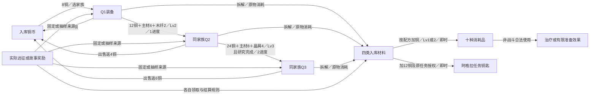

# 《火种计划：边境回响》装备功能矩阵与加工转换图

> **GEAR-AFFIX-1.0，2026-10-27覆盖说明：** 用户已采用“武器＋防具”两槽、低级纯面板／高级特殊词条／强效可配负面的方向，权威见[11§2.1](../11_战利品装备与制造.md)。下文24固定模板只作为基础面板和加工成本对照；“不增加随机词条”“成品全部固定”及由此得出的构筑宽度结论属于旧版本，不再限制新设计。基础JSON仍为旧面板基线；灰盒0.18已接实例归属、0.19已接首版词条获得与报价，0.20已接升阶订单、取消退款与同实例版本修订，见[验证记录](../../../原型/火种计划_远征灰盒/验证记录_v020.md)；0.21另接付费重铸与材料锁定，见[验证记录](../../../原型/火种计划_远征灰盒/验证记录_v021.md)；0.22进一步扩充每底型3条常规及七底型各2组强效，见[验证记录](../../../原型/火种计划_远征灰盒/验证记录_v022.md)；完整内容池和自然建筑成长尚未完成。新增重铸与材料锁定以[11§2.2](../11_战利品装备与制造.md#22-词条重铸与材料锁定)为准。

> 现行补充：TINDER-1.7已补齐八区4普通／2精英与各3张专属事件，共92遭遇、52事件；8个现场消耗品服务已登记。下文旧修订时点的空池、未开放服务与数量仅作历史依据，当前范围以[八区内容池补全](八区事件与怪物池补全.md)为准。自动战斗、经济与最终抽样仍待校准。

TINDER-1.5原审查 · GEAR-PROC-1.0 · 2026-10-26。当前由TINDER-1.7继承装备/加工数值；八区新增材料地区不改变本表配方成本。

本项完成八家族的用途与替代关系、取得路径比较、加工操作登记和资源转换核算。依据为[11战利品与制造](../11_战利品装备与制造.md)、[03战斗公式](../03_远征构筑与棋盘战斗.md)、[工坊专项](工坊升阶与消耗品制作.md)及[战利品数据](../校验/战利品.json)。沿用现行数值，不增加随机词条、触发技能或隐含获取门槛。用途判断属于设计分析，不能视为已证实的最优配装。

结构化索引见[装备加工登记](../校验/装备加工登记.json)。其用途是引用现有规则、提供可核对的登记，不是新增运行时内容池。

## 1 先区分“能穿”和“值得改变安排”

装备评价按实际实例和已知敌情进行，分别记录：能否合法装备；是否改善该人的实际职责；是否值得改变站位、队列或出征名单；是否只能回城后使用；是否只值得储备或变现。前一项成立不自动推出后一项。

玩家无需为了掉落改变队伍。保留、分配给另一实例、拆解、出售、不领取均是合法结果。不能根据当前阵容暗改掉落家族，也不假定玩家必然采用策划认为最优的选择。装备提高属性的收益要经过真实动作、合法目标、防御、向下取整、行动次数和治疗溢出核算。

## 2 八家族功能矩阵

所有数值依次为Q1/Q2/Q3。人形一战具一防具，伴兽只有适配防具槽；增加生命上限不会补当前生命。

| 家族／槽位 | 固定功能 | 合法适配 | 什么情况下影响决策 | 同槽替代与限制 |
| --- | --- | --- | --- | --- |
| EF01 铁剑／战具 | 物攻+3/5/7 | S01、S02 | 更早击倒目标可能减少敌方后续行动，且已有可靠承伤安排 | 与EF02比较输出和生命空间；S01另可选EF06。没有攻速、射程或破甲效果 |
| EF02 刃口组件／战具 | 物攻+2/3/4，生命+4/6/8 | S01、S02、M01、H01、H05 | 同时需要物理输出和可治疗的生命空间；必须考虑实际恢复机会 | S01/S02可选EF01；S01/M01/H01可选EF06；H05暂时无另一战具家族。生命不是即时盾 |
| EF03 投射弦架／战具 | 物攻+2/4/6 | S03、M03、H02、H04 | 给能实际完成物理攻击的人，比较多人之间的分配和击杀阈值 | 这些人员目前没有同槽替代家族；主要是品质与分配选择，不能称为新流派 |
| EF04 导雾晶座／战具 | 魔攻+2/4/6 | M04、H03、H06 | 实际队列会执行魔法伤害，当前缺口是输出 | 与EF05争同槽；不会提高治疗、固定盾、控制时长 |
| EF05 医护工具包／战具 | 治疗+2/4/6，生命+2/4/6 | M02、M04、H03、H06 | 有受治疗强度影响的动作、合法受伤目标和施放窗口 | M04/H03/H06可选EF04；M02暂时无另一战具家族。无治疗动作、次数耗尽或全额溢出时治疗加值无效 |
| EF06 守位扣／战具 | 物防+2/3/4，魔防+1/2/3 | S01、M01、H01 | 此人确实承担攻击，少受伤比增加输出更有价值 | 与输出战具互斥，可另配防具；不加嘲讽、不改变索敌，不是第二防具槽 |
| EF07 行军皮甲／防具 | 生命+6/10/14，物防+2/3/4 | 全部现行人形类型及PET-H04 | 实际物理承伤较多，需要物防与生命储备 | 与EF08同槽；魔法压力下未必合适，不自动抵消所有伤害 |
| EF08 隔咒披具／防具 | 生命+4/8/12，魔防+3/5/7 | 同EF07 | 已知魔法攻击可能命中该人，或关键后排需要魔防 | 与EF07同槽；不防控制、侵蚀或捕获，同人不能两种都穿 |

适配名单与模板逐条登记在JSON中。EF07/08的“全部”只指现行登记类型，不自动授权未来新增单位。

### 2.1 真正存在的五组同槽竞争

| 竞争组 | 共同适配者 | 比较条件 |
| --- | --- | --- |
| EF01 ↔ EF02 | S01、S02 | 同品质铁剑多1/2/3物攻，组件多4/6/8生命上限；比较实际击杀与存活窗口 |
| EF01 ↔ EF06 | S01 | 物攻与双防；需要真实承伤，不能假定站前排必定吸引所有攻击 |
| EF02 ↔ EF06 | S01、M01、H01 | 物攻＋生命空间与双防；混合伤害、治疗机会和当前伤势共同决定 |
| EF04 ↔ EF05 | M04、H03、H06 | 魔法伤害与治疗职责；以已装队列、剩余次数和合法目标为准 |
| EF07 ↔ EF08 | 现行全部防具适配者 | 物理／魔法压力及生命差；按人分配，不给全队自动套同一答案 |

EF01和EF03虽然都加物攻，却没有共同适配者，不是同一人的换装选择。战具和防具可以组合，不能算作互斥替代。跨品质也不能只看颜色：不同家族的属性交换依然存在；同家族更高品质则是属性提升，主要变化在投入、归属和取得时点。

### 2.2 当前能支持与尚缺的变化

现有装备支持职责偏重、人员分配和承伤类型的调整；24模板仍只有八家族，三档品质没有生成24种战术。EF03及M02、H05的战具选择尤其窄。提高升阶成本能提高直接掉落的价值，却不会自然增加构筑方向。

后续功能型装备现已按GEAR-AFFIX-1.0采用随机特殊词条与强效负面配对。首批效果、触发、次数、代价和抽样合同归11；本表只继续负责旧基底用途与加工成本。新词条适配池、权重和真实战斗收益尚待扩展及验证，不能据此标成“装备池已丰富”。

## 3 取得路径与完整代价

| 来源 | 实际取得时点 | 确定与不确定部分 | 成本与后果 |
| --- | --- | --- | --- |
| 普通装备掉落 | 到达奖励点、合法领取；可在非战斗状态给在场适配者穿；安全带回才稳定入库 | 主题内最多两家族候选，共享一次品质抽取；沿用原品质表和保底 | 占普通每趟1件装备额度，承担路线、战斗与失败丢失风险；不能称为零成本 |
| 商店Q1＋升阶 | 城镇购买；满足工坊与剧情条件后下单，实际行动结算完成 | 家族、品质与成品固定 | Q2从零购入20铜＋合并材料6份＋1进度；Q3为44铜＋合并材料18份＋顺序3进度，另计建筑投入；加工期间装备不可用 |
| 人性事件的固定装备交易 | 实际完成伤害行为并保存回执后取得提货权，下一次城镇结算兑现 | 明示固定品质，确认前从八家族选择；不抽品质 | 一次性故事账，不占普通装备预算；不可逆出卖，失去该事件保全结果与完美B资格，不自动判C |
| 重复装备 | 与对应来源相同 | 可用于第二个适配实例、替补、拆解或出售 | 升阶不吃同名装备；重复物不能凭空转成技能或未开放家族交换 |

十笔人性交易中，**四笔直接给装备**：EV07给1件Q2＋48铜；EV12给1件Q2＋6晶屑；EV22给1件Q3＋32铜；EV28给2件Q2＋64铜。其他六笔主要提供经营资源或材料，也会间接加快确定制造。全部沿用既有一次性条件，不因本次成本上涨而削减诱惑或把奖励变成劣质品。

获得适用Q3可省掉对应的44铜、18份材料和3进度，但只有“从零购入并升阶”这个比较前提下才能这样计算。已经持有Q2时，应比较24铜、该家族第二段材料和2进度；已经有多件同家族Q3时，不能重复计全额战力收益。事件奖励可能与其他铜／材料奖励合并获得，需逐笔算完整包。

**不把被俘损失、坏运气或玩家趋利倾向写成剧情必然。** 仍保留普通掉落、公开商店和确定材料委托，不能靠故意堵住正常成长迫使玩家出卖人性。具体吸引力与经济压力待整段流程验证。

## 4 加工转换图

图中的“材料→成品”是多输入配方，不代表材料单独足够。升阶支付后材料已消耗，不能再参与制药。普通物品不能拆出任务授权；消耗品不能反拆返料；阿格拉不可卖拆。外部奖励是资源流入，不是加工循环产生资源。

### 4.1 八家族的实际材料账

下表先替换主材，再合并同标签；铜与进度统一按上节。拆解只返右列，不返历史支付。

| 家族 | Q1→Q2材料 | Q2→Q3材料 | 从Q1升到Q3合计 | 拆解Q1／Q2／Q3 |
| --- | --- | --- | --- | --- |
| EF01 铁剑 | 4铁＋2木纤 | 8铁＋4晶屑 | 12铁＋2木纤＋4晶屑 | 1铁／2铁／3铁＋1晶屑 |
| EF02 刃口组件 | 4铁＋2木纤 | 8铁＋4晶屑 | 12铁＋2木纤＋4晶屑 | 同上 |
| EF03 投射弦架 | 6木纤 | 8木纤＋4晶屑 | 14木纤＋4晶屑 | 1木纤／2木纤／3木纤＋1晶屑 |
| EF04 导雾晶座 | 4晶屑＋2木纤 | 12晶屑 | 16晶屑＋2木纤 | 1晶屑／2晶屑／4晶屑 |
| EF05 医护工具包 | 4草药＋2木纤 | 8草药＋4晶屑 | 12草药＋2木纤＋4晶屑 | 1草药／2草药／3草药＋1晶屑 |
| EF06 守位扣 | 4铁＋2木纤 | 8铁＋4晶屑 | 12铁＋2木纤＋4晶屑 | 1铁／2铁／3铁＋1晶屑 |
| EF07 行军皮甲 | 6木纤 | 8木纤＋4晶屑 | 14木纤＋4晶屑 | 1木纤／2木纤／3木纤＋1晶屑 |
| EF08 隔咒披具 | 6木纤 | 8木纤＋4晶屑 | 14木纤＋4晶屑 | 同上 |

### 4.2 铜可以买到材料，但不能买到一切

保留已有的“8铜买Q1→拆出1主材”路径，并明确计入供给：EF01/02/06供铁，EF03/07/08供木纤，EF05供草药，EF04供晶屑。不是新增材料商店，也不声称材料只能由随机掉落取得。

由此推导的条件价格：如果全部缺料均用这条路径购买，Q2从零取得为**68铜**（8＋12＋6×8），Q3为**188铜**（8＋12＋24＋18×8）。八家族材料标签不同，但份数相同。这是当前路径的全购成本，**不是推荐售价或所有来源中的最优价格**；不含工坊建筑、成长、补给费用，也不能绕过剧情与进度门槛。

阿格拉全部材料以此补齐时为108铜（12＋12×8），还必须满足原任务授权与建筑条件。不得据此宣称铜可以购买根权限。升阶材料需求上升后，这条铜转材料路径可能比刷取更有吸引力；目前先明确保留，是否调整须结合整章收入、消费与实际使用率验证。

### 4.3 消耗品与长期装备的竞争

| 配方 | 工坊 | 材料＋制作铜 | 全部材料经Q1拆解购入时总铜 |
| --- | --- | --- | ---: |
| CO01 止血膏 | Lv1 | 2草药＋1木纤＋2铜 | 26 |
| CO02 合用药箱 | Lv2 | 4草药＋2木纤＋4铜 | 52 |
| CO03 束带护片 | Lv1 | 2铁＋1木纤＋3铜 | 27 |
| CO04 锐刃油 | Lv1 | 1铁＋1草药＋1木纤＋3铜 | 27 |
| CO05 导雾粉 | Lv1 | 2晶屑＋1草药＋3铜 | 27 |
| CO06 医护预备包 | Lv1 | 2草药＋1晶屑＋3铜 | 27 |
| CO07 抗冲衬垫 | Lv2 | 2铁＋2木纤＋3铜 | 35 |
| CO08 隔咒衬垫 | Lv2 | 2木纤＋2晶屑＋3铜 | 35 |
| CO09 定心香囊 | Lv2 | 2草药＋1木纤＋2晶屑＋5铜 | 45 |
| CO10 涉水绑脚 | Lv1 | 2木纤＋1草药＋3铜 | 27 |

全购价格揭示一种待测风险：缺材料时，短期消耗品可能显得比8铜的永久Q1昂贵。不能直接推出“消耗品没用”，因为实际材料可能已由远征带回、永久装备槽也可能已满；同样不能把掉落材料当作完全没有机会成本。

铁料竞争输出/守位升阶与物理准备；木纤竞争三种主材家族、其他家族首升辅材及多种防护；草药竞争EF05升阶与恢复；晶屑竞争所有二升、EF04主材、魔法准备和任务钥匙。预览应显示剩余材料与未满足需求，玩家自行决定用途，不自动锁死“正确预算”。

每趟4份携行／已用预备额度、同组覆盖和战中禁用继续有效。不能把可制作数量当作单场可叠加数量，也不能把消耗品直接折算成同价值装备。

## 5 操作登记与防套利边界

以下“可用”表示现行设计有规则，不表示引擎已经实现。详细输入、去向、结果预览、限制和回执字段见登记JSON。

| 操作 | 登记状态 | 核心边界 |
| --- | --- | --- |
| Q1购买 | 现行规则 | 公开选家族、固定8铜；一次扣款只生成一个新实例 |
| 城镇升阶 | 灰盒0.20已接；高级门槛受控验证 | 同实例、同家族、逐级；材料及铜付款锁物，结算推进，不能改适配和技能 |
| 城镇词条重铸／材料锁定 | 灰盒0.21已接，0.22扩充替代组合；无候选不收费 | 同实例、同底型／品质／面板，付材料保留部分词条；强效与负面整组处理。付费后仅生成一份候选，选新或留旧均耗费，详情归11§2.2及§2.5；旧登记JSON尚不含此边 |
| 撤销升阶订单 | 灰盒0.20已接 | 仅未完成；返原品质，按进度退已付资源；完成与取消互斥 |
| 城镇拆解 | 现行规则 | 消耗真实且可处置实例，先卸装，无任何占用锁；固定返料，不返历史投入 |
| 装备出售 | 现行规则 | 2/4/6铜；销毁与入账同提交，任务物不可售 |
| 消耗品制作 | 现行规则 | 固定配方、工坊等级、入库材料、批量原子提交；即时且不占装备位 |
| 现场消耗品制作 | 八个事件服务已登记 | 一次事件按指定原配方产一份；随行材料＋已入账铜，携行上限4，选择与制作共用回执 |
| 阿格拉组装 | 现行规则 | 原授权条件与唯一任务回执；即时且不占装备位 |
| 野外升品 | 预留未启用 | 尚无对应登记事件，不算作当前可用转换边 |
| 野外交换 | 预留未启用 | 不能假定在路上随时把错家族换成目标家族 |
| 野外拆解 | 入口证据待补 | 数据有野外材料额度约束，但没有完整入口/服务登记；暂不计作无条件可用供给，不由字段推断随处可拆 |

购买、拆解、出售的具体回执字段名在此为实现登记建议；主数据尚未像升阶/制作那样列全独立事务对象。接入时需补正式schema，同ID不同载荷应拒绝，失败不半扣、不部分生成；这些检查不能靠静态文档证明真实磁盘可靠性。

**局部循环核算：** 给铜记值1、每份材料记值8、装备记其固定拆解产物的材料值，则Q1/Q2/Q3分别记8/16/32。这里只用于检查转换会不会凭空增加可回收资源，不代表战力或可售价格。

- 买Q1与拆解各不增该值；直接卖Q1只回2铜，少6铜。
- Q1→Q2消耗12铜和6份材料，回收值只增加8，净减52；Q2→Q3消耗24铜和12份材料，回收值只增加16，净减104。
- 制作消耗品或钥匙后无材料／铜返售路径；取消最多返已付量，已完成不能再退款。部分进度取消的向下取整也不能增加资源。
- 所以在已登记、正确原子结算的这些转换边内，没有资源增殖循环。此结论不包含外部奖励、未登记交易、存档漏洞或未来新增配方；不能扩大成“整个经济已平衡”。

## 6 验收与后续优先项

| 用例 | 应满足的结果 |
| --- | --- |
| 相同模板给不同角色 | 适配、已装动作、目标与剩余次数分别判断，不能只按物品颜色推荐 |
| 低血角色换加生命装备 | 维持绝对当前生命并夹上限，不生成即时治疗；倒地仍为0 |
| 治疗包给无治疗队列者 | 显示生命修正与当前治疗加值缺少作用入口，不伪造医疗技能 |
| 高品质但无人适配的掉落 | 允许合法保留／不领；不改变种子、家族或保底结果 |
| EF04升阶后拆解 | 按同材合并计账，Q3固定返4晶屑，不返16晶屑历史投入 |
| 消耗品与订单同时争料 | 先提交的交易消耗后，后一个重新核验余额；不能双花 |
| 出卖获取Q3后再掉同Q3 | 区分第二实例的适配者、储备与回收价值，不重复记首次战力提升 |
| 野外只有预留接口 | 不纳入现行可达操作或期望收益 |

GEAR-01矩阵、GEAR-02来源比较、PROC-01转换图和PROC-02操作清单在文档层面已补齐；平衡、功能型扩池、正式事务接入和野外加工事件仍待完成。主设计保持TINDER-1.5，随机框架同步为RNG-DRAFT-0.3。

原审查的后续建议（当前排期以[总路线图](../../../开发总路线图_执行版.md)为准）为**敌阵职能与地区／威胁候选登记**：把普通遭遇、教学、精英、固定首领分开，逐阵列压力来源、可用反制与禁止组合。它将提供判断上述装备和消耗品“什么时候值得用”的具体场景，再据此扩装备功能，避免只凭属性表继续堆物品。

校核见[装备加工检查结果](../校验/装备加工校核结果.json)。修订前完整包及四入口的38文件已保存在[快照](../../../历史材料/文案归档/火种计划_TINDER-1.5_装备加工矩阵补全前_20261026/README.md)，该次审查保持七份主数据与原PDF原字节；后续八区变更另由[八区修订登记](../校验/八区修订登记.json)核对。
